# HustleHub+ — Secure Stack (Part 3)

**Module:** Information Systems 3D (INSY7314/w) / Application Development Security (APDS7311/w)
**POE Part:** 3 of 3 — DevSecOps, Monitoring and Finalisation
**Student:** Evanildo Julio Chaves Jose (ST10437401) — Group Leader
**Student:** Mohamed Ahmed (ST10448258)
**Student:** Tawfeeq Gallie (ST10434369)
**Student:** Fay-yaad Parker (ST10434066)
**GitHub:** [evanildo26](https://github.com/evanildo26)
**Stack:** MERN — **M**ongoDB · **E**xpress · **R**eact · **N**ode.js, containerised with Docker and delivered through GitHub Actions

| Demonstration video | Link |
|---|---|
| Part 3 — final system, DevSecOps and monitoring | _add YouTube link here_ |
| Part 2 — full application flow | https://www.youtube.com/watch?v=sV-b-_eWlsY |
| Part 1 — secure backend foundations | https://www.youtube.com/watch?v=HqpkX3bnkW0 |

[](https://github.com/evanildo26/hustlehub-plus-part3/actions/workflows/ci-cd.yml)
[](https://github.com/evanildo26/hustlehub-plus-part3/actions/workflows/codeql.yml)

---

## Table of Contents

1. [Project Overview](#1-project-overview)
2. [What Changed in Part 3](#2-what-changed-in-part-3)
3. [Architecture](#3-architecture)
4. [Features by Role](#4-features-by-role)
5. [Tax Estimation and the Income Dashboard](#5-tax-estimation-and-the-income-dashboard)
6. [Project Structure](#6-project-structure)
7. [Security Implementation](#7-security-implementation)
8. [Additional Security Features (Part 3)](#8-additional-security-features-part-3)
9. [Logging and Monitoring](#9-logging-and-monitoring)
10. [Getting Started](#10-getting-started)
11. [API Reference](#11-api-reference)
12. [Testing](#12-testing)
13. [CI/CD Pipeline](#13-cicd-pipeline)
14. [Static Code Analysis and Security Scanning](#14-static-code-analysis-and-security-scanning)
15. [Final Security Review](#15-final-security-review)
16. [Demonstration Evidence](#16-demonstration-evidence)
17. [Known Limitations](#17-known-limitations)
18. [References](#18-references)

---

## 1. Project Overview

HustleHub+ is a freelance marketplace. **Freelancers** advertise services ("gigs"), **clients** browse and book them, and every booking produces a **transaction record**. Freelancers can track the income they have earned and see an **estimate of the income tax** they owe on it. **Admins** oversee the platform and monitor its security.

| Role | What they can do |
|---|---|
| **Client** | Browse and search gigs, book gigs (simulated payment), view and cancel their own bookings, view their payment history. |
| **Freelancer** | Create, edit, list/unlist and delete their **own** gigs, manage bookings on them, track income, and use the **Earnings & tax dashboard** (SARS tax estimate, charts and provisional tax schedule). |
| **Admin** | View platform statistics, users, all bookings and transactions (read-only), remove any gig, watch the **Security monitor** and **revoke a user's sessions**. Admins cannot self-register. |

The platform handles credentials, personal data and financial records, so security was designed in from Part 1. Part 3 adds the DevSecOps layer: every change is automatically tested, analysed, scanned, containerised and run as a full stack before it can be delivered.

---

## 2. What Changed in Part 3

| Area | Part 2 | Part 3 |
|---|---|---|
| Financial insights | Income summary (net, gross, fees, monthly table) | **SARS tax estimation** (2026/27 brackets, rebates by age, annualised projection, provisional tax) and an **Earnings & tax dashboard** with accessible SVG charts |
| CI/CD | None | **GitHub Actions** pipeline: lint, 94 backend + 68 frontend tests, Newman, production build, SAST, secret scan, dependency audit, image scan, full-stack run in Docker, DAST, delivery to Docker Hub; plus **CodeQL** and **Dependabot** |
| Static analysis | oxlint on the client | **ESLint + eslint-plugin-security + eslint-plugin-n** on the API, **Semgrep** (155 rules), **CodeQL** (security-extended); every finding fixed or justified ([§14](#14-static-code-analysis-and-security-scanning)) |
| Deployment | `npm start` / `npm run dev` | **Dockerfiles** in `api/` and `client/` (multi-stage, non-root, read-only) and **Docker Compose** with segmented networks and health checks |
| Logging | JSON lines to a local file | **Cloud logging (Better Stack)**, request ids, secret redaction, email masking, structured HTTP logs, graceful log flushing |
| Monitoring | — | **Security monitor**: events stored for the admin dashboard and automatic **SECURITY_ALERT**s for brute force, probing, injection and token tampering |
| Own security features | — | **Per-account lockout**, **token revocation** (logout + admin "revoke sessions"), **security monitoring and alerting**, plus prototype-pollution stripping found by static analysis |
| Testing | 54 backend / 53 frontend / 130 Newman assertions | **94** backend / **68** frontend / **172** Newman assertions (91 requests), also run against the containerised stack |

---

## 3. Architecture

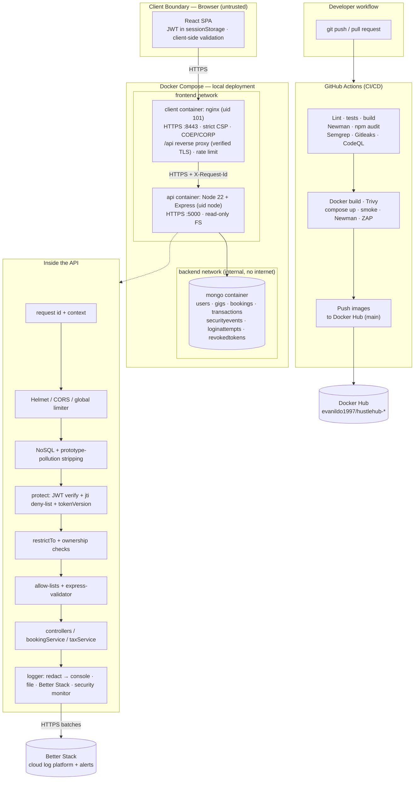

**Request flow (freelancer opens the tax dashboard):**

1. The browser calls `GET /api/income/tax-estimate` on its own origin (`https://localhost:8443`). nginx rate-limits it, gives it a request id and proxies it to the API over HTTPS, **verifying the API's certificate**.
2. The API stamps every later log line with that request id, applies security headers, CORS and the global limit, and strips `$`, dotted and `__proto__` keys.
3. `protect` verifies the JWT (HS256, issuer, audience, expiry), checks its `jti` is not on the logout deny-list and its `tv` matches the user's `tokenVersion`, then reloads the user so the role is current.
4. `restrictTo('freelancer')` rejects other roles (`403`, logged as `ACCESS_DENIED`), and the optional `ageGroup` query is validated against an allow-list.
5. `taxService` aggregates **only this freelancer's** transactions in the current tax year and applies the SARS tables. The page draws the result.

**Trust boundaries:** the browser is untrusted; nginx is the only published entry point; the API is the security boundary; MongoDB sits on an **internal** network that only the API can reach and has no route to the internet.

---

## 4. Features by Role

**Client**
- Marketplace with keyword search, category chips with live counts and pagination.
- Book a gig with notes; simulated payment returns `SIM-PAY-…` and `TXN-…` references.
- My bookings (cancel a confirmed booking → refund) and Payments history.

**Freelancer**
- My gigs: create, edit, list/unlist, delete own gigs.
- Bookings on own gigs: complete or cancel.
- **Earnings & tax** (new): amount to set aside for SARS, projected annual income, estimated annual tax, effective and marginal rate, monthly income-vs-tax chart, where client payments go, provisional tax payments, tax-bracket breakdown with the calculation explained, all-time monthly table and top gigs.
- Transactions with the fee split.

**Admin**
- Dashboard with platform statistics.
- **Security monitor** (new): alerts, failed logins, lockouts, access denials, injection attempts, bad or revoked tokens, rate-limit hits, recent events and most active source IPs, for the last 24 hours, 7 days or 30 days.
- **Revoke sessions** (new) for any user; gig moderation; user list.

---

## 5. Tax Estimation and the Income Dashboard

### 5.1 Why and what

Freelancers on HustleHub+ are sole proprietors. SARS taxes their platform income at the normal **individual** rates and expects it to be paid in advance as **provisional tax** in two instalments [19]. A freelancer who spends everything they earn gets a large bill later, so the dashboard answers one practical question: *how much of what I have earned should I keep aside for tax?*

### 5.2 The calculation (`api/src/services/taxService.js`)

| Step | Rule | Why |
|---|---|---|
| 1. Taxable income | Sum of the freelancer's **net earnings** (`freelancerEarnings`, after the 10% platform fee, net of refunds) for transactions in the **current SA tax year** (1 March – end of February). | The fee is never received by the freelancer, so it isn't their income. Refunds are negative rows, so they reduce income automatically. |
| 2. Annualise | `projected = year-to-date ÷ months elapsed × 12` | Tax is charged on a full year. Half-way through the year, the freelancer needs to know which bracket they are heading for. |
| 3. Annual tax | SARS bracket formula `base + rate × (income − bracket start)`, **minus the rebate** for the age group (primary R17 820; +R9 765 at 65+; +R3 249 at 75+ for 2026/27), never below 0. | Official SARS tables for the tax year (2025/26 and 2026/27 are both included, so the year is chosen by date). |
| 4. Effective rate | `annual tax ÷ projected income` | Applied to each month's income to show how much of that month to set aside. |
| 5. Provisional tax | Half of the annual estimate by **31 August**, the balance by the **last day of February**. | The two IRP6 payment dates. |

**2026/27 brackets used** [19]:

| Taxable income (R) | Rate |
|---|---|
| 1 – 245 100 | 18% |
| 245 101 – 383 100 | 44 118 + 26% above 245 100 |
| 383 101 – 530 200 | 79 998 + 31% above 383 100 |
| 530 201 – 695 800 | 125 599 + 36% above 530 200 |
| 695 801 – 887 000 | 185 215 + 39% above 695 800 |
| 887 001 – 1 878 600 | 259 783 + 41% above 887 000 |
| 1 878 601 + | 666 339 + 45% above 1 878 600 |

**Worked example (demo freelancer Thandiwe, 13 October 2026, 8th month of 2026/27):**

```
Year-to-date net income        R164 160.00
Projected annual income        164 160 ÷ 8 × 12           = R246 240.00
Tax before rebate (26% band)   44 118 + 26% × (246 240 − 245 100) = R44 414.40
Primary rebate (under 65)                                 − R17 820.00
Estimated annual tax                                       = R26 594.40
Effective rate                 26 594.40 ÷ 246 240         = 10.8%
Set aside so far               164 160 × 10.8%             = R17 729.60
Provisional tax                R13 297.20 by 31 Aug 2026 and R13 297.20 by 28 Feb 2027
```

**Assumptions** (also shown on the page): income from outside HustleHub+, deductible business expenses, retirement-fund contributions and medical tax credits are not included. The figure is a planning estimate, not a tax return.

**Security of the feature:** `GET /api/income/tax-estimate` is freelancer-only, the aggregation is filtered by the caller's id inside the database query (another freelancer always sees R0 of someone else's income), and `ageGroup` is validated against an allow-list (`under65`, `65to74`, `75plus`). Sixteen tests cover the brackets, rebates, tax-year boundaries and access control (`api/tests/tax.test.js`).

### 5.3 The dashboard (`client/src/pages/EarningsPage.jsx`)

| Element | Shows |
|---|---|
| Headline figure | Amount to set aside so far, with a below-threshold message when no tax is due |
| Stat tiles | Net income (all time), projected annual income, estimated annual tax, effective/marginal rate, bookings |
| **Monthly income and tax** chart | Stacked columns for the 12 months of the tax year (take-home + tax to set aside), hover/keyboard tooltip, **"Show as table"** view |
| **Where client payments go** | 100% bar: you keep / set aside for tax / platform fee, with values and percentages in the legend |
| **Provisional tax payments** | Both IRP6 instalments with due dates |
| **How your tax is calculated** | Income in each bracket and the tax it attracts, "Your top bracket", the formula and the method steps |

The charts are hand-written **SVG** (no chart library), so they work under the strict production CSP (`style-src 'self'`). Colours were checked with a colour-vision-deficiency validator, identity never depends on colour alone (legends, labels and a table view), the chart is drawn at the container's real width so it stays readable on a phone, and every value is reachable by keyboard.

---

## 6. Project Structure

```
hustlehub-plus-part3/
├── .github/
│   ├── workflows/ci-cd.yml            # CI/CD pipeline (see §13)
│   ├── workflows/codeql.yml           # CodeQL security analysis
│   └── dependabot.yml                 # Weekly dependency / image / action updates (7-day cooldown)
├── .zap/rules.tsv                     # OWASP ZAP baseline rule overrides (with reasons)
├── docker-compose.yml                 # mongo + api + client, segmented networks, hardening
├── .env.example                       # Compose settings (JWT_SECRET, admin, Better Stack)
├── api/                               # Express + MongoDB backend
│   ├── Dockerfile · .dockerignore · docker-entrypoint.sh
│   ├── eslint.config.js               # ESLint + security + Node plugins
│   ├── server.js                      # HTTPS bootstrap, graceful shutdown + log flush
│   ├── scripts/                       # generateCert · seedAdmin · seedDemo · runNewman · healthcheck
│   ├── postman/
│   │   ├── HustleHub-Part3.postman_collection.json   # 9 folders, 87 requests (91 executed), 172 assertions
│   │   └── buildPart3Collection.js    # Generates Part 3 = Part 2 + tax + security folders
│   ├── src/
│   │   ├── app.js                     # Middleware order, security monitor start-up
│   │   ├── config/env.js              # Fail-fast config incl. lockout, alert, trust-proxy settings
│   │   ├── models/                    # user · gig · booking · transaction
│   │   │                              # + loginAttempt · revokedToken · securityEvent (TTL indexes)
│   │   ├── services/                  # bookingService · taxService · loginLockout · securityMonitor
│   │   ├── middleware/                # auth (JWT + revocation) · httpLogger · rateLimiter · sanitizeRequest
│   │   │                              # · securityHeaders · errorHandler · validators/
│   │   └── utils/                     # logger (redaction, Better Stack) · requestContext · jwt · sanitize
│   └── tests/                         # 94 Vitest + Supertest tests (auth, gigs, bookings, tax, security, Part 3 features)
├── client/                            # React 19 + Vite frontend
│   ├── Dockerfile · .dockerignore
│   ├── nginx/                         # default.conf · security-headers.conf · 15-generate-cert.sh
│   └── src/
│       ├── components/charts/         # MonthlyTaxChart · IncomeSplitBar · TaxBracketBars
│       ├── components/SecurityMonitor.jsx
│       ├── pages/                     # EarningsPage (tax dashboard), AdminPage (+ monitor, revoke), ...
│       └── tests/                     # 68 Vitest + Testing Library tests
└── docs/
    ├── screenshots/part1 · part2 · part3/
    └── evidence/ · evidence/part3/    # Test, lint, scan, Newman, ZAP, Docker and log evidence
```

Routes map URLs to middleware chains, middleware holds the cross-cutting security concerns, controllers stay thin and enforce ownership, services hold multi-step logic (bookings, tax, lockout, monitoring), and only models touch MongoDB, following Express's middleware-chain model [5].

---

## 7. Security Implementation

Parts 1 and 2 established the controls below; Part 3 tightened several of them (marked **P3**).

### 7.1 Authentication and sessions
- **bcrypt (cost 12)**; hash `select: false` and stripped by `toJSON` [1].
- **Timing-safe login** and an identical `401` for unknown email and wrong password [1][3].
- **JWT** pinned to HS256, with `iss`, `aud` and 1-hour expiry, and a secret of at least 32 characters (startup fails otherwise) [2].
- **P3:** each token has a unique `jti` and a `tv` (token version), so it can be **revoked** before it expires (§8.2).
- **P3:** **per-account lockout** after 5 failures (§8.1), on top of the per-IP login limiter.

### 7.2 Authorisation
- `restrictTo()` on every protected route plus **ownership checks** in controllers (IDOR protection, `OWNERSHIP_VIOLATION` log) [9].
- List and aggregation queries are scoped by the caller's id in the query itself (bookings, transactions, income, **tax estimate**).

### 7.3 Input validation and sanitisation
- express-validator on every input, type guards, HTML/angle-bracket stripping for free text (stored XSS); React escapes everything it renders [4][12][14].
- NoSQL operator stripping, Mongoose `strictQuery`, mass-assignment allow-lists [10][13][18].
- **P3:** **prototype-pollution keys** (`__proto__`, `constructor`, `prototype`) are stripped and logged (`PROTOTYPE_POLLUTION_ATTEMPT`), a finding from static analysis [31].
- **P3:** price validation rewritten without a nested-quantifier regex (ReDoS-safe).

### 7.4 Rate limiting
Login (10 failed / 15 min / IP), register (20 / 15 min / IP), booking (10 / 15 min / user), global (300 / 15 min / IP), all with `429`, `Retry-After` and `retryAfterSeconds` [15]. **P3:** nginx adds a 20 req/s per-IP limit in front of `/api`, and `TRUST_PROXY=1` makes the API see the **real client IP** behind nginx.

### 7.5 Security headers and CSP
- API: Helmet with `default-src 'none'`, HSTS, `frame-ancestors 'none'`, `no-store` [8][11].
- Web app (nginx in Docker, `vite preview` locally): `script-src 'self'`, `style-src 'self'`, `connect-src 'self'`, `object-src 'none'`, `frame-ancestors 'none'`, HSTS, nosniff, `Referrer-Policy: no-referrer`, Permissions-Policy, COOP. **P3:** COEP `require-corp` and CORP `same-origin` (ZAP finding), `no-cache, no-store, must-revalidate` on HTML, fonts never inlined as `data:` URLs (a build setting that would have violated `font-src 'self'`).

### 7.6 Transport and error handling
HTTPS everywhere: browser → nginx (TLS 1.2/1.3), and nginx → API over TLS **with certificate verification** (`proxy_ssl_verify on`), with HSTS telling browsers never to fall back to HTTP [6][7]. The central error handler never returns stack traces, paths or config [3].

### 7.7 Container security (P3)

The images and Compose file follow the OWASP Docker Security Cheat Sheet and Docker's own guidance [21][29]:

| Control | Where |
|---|---|
| Multi-stage builds, production dependencies only, no npm/npx/corepack in the API image | `api/Dockerfile` |
| Non-root users (`node`, nginx uid 101), no ports below 1024 | both Dockerfiles |
| `read_only` root filesystem, `cap_drop: ALL`, `no-new-privileges` | `docker-compose.yml` |
| MongoDB on an **internal** network; API and DB publish **no host ports** | `docker-compose.yml` |
| OS packages patched at build time (`apk upgrade`) | both Dockerfiles |
| Health checks that verify TLS with the server's own certificate | `api/scripts/healthcheck.js` |
| `tini` as PID 1 so SIGTERM reaches Node (graceful shutdown + log flush) | `api/Dockerfile`, `server.js` |
| Secrets only via `.env` (git-ignored) and environment, never baked into images (`.dockerignore`) | both |

---

## 8. Additional Security Features (Part 3)

Three features go beyond the minimum requirements. Each is functional, tested and visible in the UI.

### 8.1 Per-account login lockout

**Problem:** the Part 2 limiter counts failures **per IP**. An attacker with many IPs (a botnet or rotating proxies) can still try thousands of passwords against **one** account.

**Implementation** (`services/loginLockout.js`, `models/loginAttemptModel.js`):
- Failed logins are counted **per email address** with an atomic `$inc`. After **5 failures within 15 minutes** the email is locked for **15 minutes**, whatever IP the next attempt comes from.
- While locked, even the **correct** password is refused with `423 Locked`, a clear message and `Retry-After: 900`, and no password check is run.
- The counter is keyed by the **typed email**, so an address with **no account locks exactly like a real one**. The lockout cannot be used to discover which emails are registered.
- A successful login clears the counter. Records expire by themselves (MongoDB TTL index).
- Logged as `LOGIN_FAILED` (with `failuresInWindow`), `ACCOUNT_LOCKED` and `LOGIN_BLOCKED_LOCKED`, with masked emails.

**Trade-off:** someone could deliberately lock a victim out. The lock is therefore short and lifts by itself, and every lock appears on the Security monitor [30].

**Tests:** lock after 5, right password still refused, unknown and real emails give identical responses, counter reset on success, masked email in the event (`tests/securityFeatures.test.js`); Newman folder 8 loops until the lock.

### 8.2 Token revocation: logout and admin "revoke sessions"

**Problem:** a JWT stays valid until it expires (up to 1 hour). Logging out in the browser only deleted the local copy. A token copied from the machine, a log or a proxy kept working.

**Implementation:**
- Every token gets a unique id (`jti`) and the user's `tokenVersion` (`tv`) [2].
- `POST /api/auth/logout` puts the token's `jti` on a **deny-list** (`revokedTokenModel`) until its original expiry (TTL index, so the list only ever holds live tokens). The React app calls it before clearing the session.
- `POST /api/admin/users/:id/revoke-sessions` increments the user's `tokenVersion`, so **every** token issued before that moment fails. This is incident response for a compromised account. The **Revoke sessions** button is on the admin Users table.
- `protect` rejects revoked tokens with "Your session has ended. Please log in again." (`REVOKED_TOKEN_USED`) and also rejects tokens without a `jti`.

**Tests:** logout kills only that token while other sessions keep working; admin revocation kills all of a user's tokens, after which a fresh login works; only admins can revoke; ids are validated; a correctly signed token without `jti` is refused. Frontend tests confirm logout calls the API and still clears the session when the network fails.

### 8.3 Security monitoring and alerting

**Problem:** logs are only useful if someone notices the pattern. Ten failed logins from one IP in five minutes is an attack; one is a typo.

**Implementation** (`services/securityMonitor.js`):
- Subscribes to the logger. Every `security` and `alert` event is stored in MongoDB (`SecurityEvent`, kept 30 days with a TTL index).
- Keeps a sliding 5-minute window per IP of suspicious events (failed or blocked logins, lockouts, access denials, ownership violations, invalid or revoked tokens, injection and prototype-pollution attempts, rate-limit hits). At **10 events** it raises **one** `SECURITY_ALERT` naming the pattern (`BRUTE_FORCE_LOGIN`, `ACCESS_PROBING`, `INJECTION_ATTEMPTS`, `TOKEN_TAMPERING` or `SUSPICIOUS_ACTIVITY`), then stays quiet for that window.
- Alerts are log entries like any other, so they reach **Better Stack**, where an alert rule can email the team (§9.3).
- `GET /api/admin/security-events?hours=` feeds the admin **Security monitor**: alert banners (icon and label, never colour alone), totals, recent events in plain language, and most active source IPs.

**Tests:** 12 failures from one IP produce exactly one `BRUTE_FORCE_LOGIN` alert; summary totals; admin-only access; `hours` validated; frontend tests for alerts, totals, period filter and revocation.

### 8.4 Smaller hardening (found during Part 3)
- **Request ids:** every response carries `X-Request-Id`. nginx generates it and the API reuses it if safe, so one id traces a request through nginx, the API and Better Stack.
- **Log redaction:** any field named like a password, token, secret, cookie or authorization header is replaced with `[REDACTED]` before it is written anywhere. Emails in auth logs are masked (`th***@domain`), for POPIA data minimisation [20].
- **Prototype-pollution stripping** and the **ReDoS-safe** price check (§14).
- **Supply chain:** GitHub Actions pinned to commit SHAs; Dependabot with a 7-day cooldown.

---

## 9. Logging and Monitoring

### 9.1 What is logged and why

Every entry is one JSON object with `timestamp`, `level`, `event`, `service`, `env`, `requestId`, `ip`, `userId` (when known) and event-specific fields. Passwords, tokens and hashes are never logged.

| Category | Events | Why it matters |
|---|---|---|
| **Login attempts** | `LOGIN_SUCCESS`, `LOGIN_FAILED` (reason, failures in window, masked email), `ACCOUNT_LOCKED`, `LOGIN_BLOCKED_LOCKED`, `LOGOUT`, `REGISTER_SUCCESS` | Detect brute force and credential stuffing, and reconstruct who accessed an account and when |
| **Access control** | `ACCESS_DENIED`, `OWNERSHIP_VIOLATION`, `INVALID_TOKEN_ATTEMPT`, `REVOKED_TOKEN_USED`, `SESSIONS_REVOKED` | Spot privilege-escalation and IDOR probing, stolen or forged tokens, and incident response actions |
| **Attacks blocked** | `NOSQL_INJECTION_ATTEMPT`, `PROTOTYPE_POLLUTION_ATTEMPT`, `RATE_LIMIT_EXCEEDED`, `SECURITY_ALERT` | Evidence that controls are working, plus the trigger for alerts |
| **Bookings and transactions** (audit) | `GIG_CREATED/UPDATED/DELETED`, `BOOKING_CREATED/COMPLETED/CANCELLED`, `TRANSACTION_RECORDED` | A money trail: every payment and refund can be traced to a booking, user and request |
| **Errors** | `REQUEST_ERROR` (4xx warn, 5xx error with stack, server-side only), `DB_CONNECTION_FAILED`, `UNHANDLED_REJECTION`, `UNCAUGHT_EXCEPTION` | Find faults without ever exposing details to users |
| **Operations** | `SERVER_STARTED` (incl. whether cloud logging is on), `SERVER_STOPPING`, `DB_CONNECTED`, `HTTP_REQUEST` (method, path, status, duration ms, user agent) | Availability, latency and traffic trends |

This follows the OWASP guidance to log authentication, authorisation and input-validation failures with enough context to investigate, without sensitive data [20].

### 9.2 Where logs go

| Destination | Purpose |
|---|---|
| Console | Live view (`docker compose logs -f api`) |
| `api/src/logs/events.log` (Docker volume `api-logs`) | Durable local copy that survives restarts and network outages |
| **Better Stack** (cloud) | Search, live tail, dashboards and alerting across restarts and machines |
| MongoDB `securityevents` | The in-app admin Security monitor (30 days) |

Shipping to Better Stack is **batched** (50 entries or every 2 s), never blocks a request, retries network and 5xx errors with a bounded in-memory queue, drops the queue on a bad token (`403`) instead of retrying forever, and **flushes on shutdown** (`SIGTERM`). Ingestion uses Better Stack's HTTPS endpoint with a bearer source token [28].

### 9.3 Setting up Better Stack

1. Create a free account at [betterstack.com](https://betterstack.com) → **Telemetry → Sources → Connect source → HTTP**.
2. Copy the **source token** and **ingesting host** into `.env` (Docker) or `api/.env` (local):
   ```
   BETTERSTACK_SOURCE_TOKEN=<token>
   BETTERSTACK_INGEST_HOST=<your ingesting host>
   ```
3. Restart the API. `SERVER_STARTED` now shows `cloudLogging: true`, and events appear in **Live tail**.
4. Useful saved searches: `level:"security"`, `event:"SECURITY_ALERT"`, `status>=500`, or `requestId:"<id>"` for one request's full story.
5. Create an **alert** on `event:"SECURITY_ALERT"` (or on more than 0 `level:"error"` in 5 minutes) to get an email when an attack pattern is detected.

**Better Stack Live tail** for the `HustleHub+ API` source, showing a brute-force attempt end to end: `LOGIN_FAILED` → `ACCOUNT_LOCKED` → `SECURITY_ALERT` → `LOGIN_BLOCKED_LOCKED` (423), followed by a `LOGOUT` and the `REVOKED_TOKEN_USED` rejection of the logged-out token:

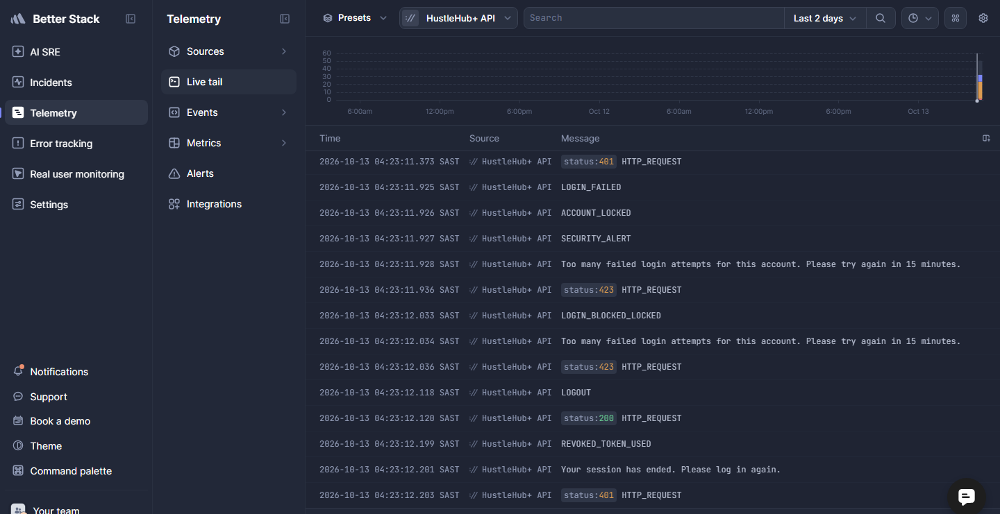

More evidence: the admin Security monitor ([`07-admin-security-monitor.png`](docs/screenshots/part3/07-admin-security-monitor.png)) and [`docs/evidence/part3/api-events-log-sample.txt`](docs/evidence/part3/api-events-log-sample.txt) (raw JSON lines from the API container).

---

## 10. Getting Started

### 10.1 Option A — Docker (recommended: the whole stack in one command)

Prerequisite: [Docker Desktop](https://www.docker.com/products/docker-desktop/) (Compose v2).

```bash
cp .env.example .env
# Set JWT_SECRET (32+ random characters) and ADMIN_PASSWORD in .env:
node -e "console.log(require('crypto').randomBytes(48).toString('hex'))"

docker compose up -d --build --wait                    # mongo + api + client, waits for health checks
docker compose exec api node scripts/seedAdmin.js      # admin account
docker compose exec api node scripts/seedDemo.js       # optional demo data (29 gigs, a year of bookings)
```

Open **https://localhost:8443** (accept the self-signed certificate warning once). `http://localhost:8080` redirects to HTTPS.

| Command | Purpose |
|---|---|
| `docker compose ps` | Status and health of the three containers |
| `docker compose logs -f api` | Live API logs |
| `docker compose exec api tail -f src/logs/events.log` | Raw JSON event log |
| `cd api && BASE_URL=https://localhost:8443 npm run test:api` | Run the Newman collection against the containers (needs `ADMIN_EMAIL`/`ADMIN_PASSWORD` in `api/.env` or the environment) |
| `docker compose down` / `down -v` | Stop (and delete data volumes) |

Pre-built images are also published by the pipeline: `docker pull evanildo1997/hustlehub-api` and `evanildo1997/hustlehub-client`.

### 10.2 Option B — Local development

Prerequisites: Node.js **22.12+**, MongoDB Community Server on `mongodb://127.0.0.1:27017`.

```bash
cd api
npm install
cp .env.example .env            # set JWT_SECRET (32+ chars) and ADMIN_PASSWORD (optionally BETTERSTACK_*)
npm run generate-cert           # self-signed HTTPS certificate in api/certs
npm run seed:admin
npm run seed:demo               # optional
npm start                       # https://localhost:5000

cd ../client
npm install
npm run dev                     # https://localhost:5173  (production build: npm run build && npm run preview)
```

### Demo accounts

| Role | Email | Password |
|---|---|---|
| Freelancer (a full tax year of bookings) | `thandiwe@demo.hustlehub.local` | `DemoPass1!` |
| Client | `sipho@demo.hustlehub.local` / `amahle@demo.hustlehub.local` | `DemoPass1!` |
| Admin | `ADMIN_EMAIL` in `.env` | `ADMIN_PASSWORD` in `.env` |

> Demo credentials are for local use only. Five wrong passwords lock a demo account for 15 minutes, which is expected (§8.1).

---

## 11. API Reference

All responses: `{ "success": boolean, "message"?: string, "data"?: ..., "errors"?: [{ "field", "message" }] }`. Every response carries `X-Request-Id`. New Part 3 endpoints are in **bold**.

| Method | Endpoint | Auth | Description |
|---|---|---|---|
| GET | `/api/health` | — | Health check |
| POST | `/api/auth/register` | — | Register client/freelancer (rate limited) |
| POST | `/api/auth/login` | — | Log in, returns JWT (IP limit + **account lockout → 423**) |
| **POST** | **`/api/auth/logout`** | JWT | **Revoke the token used for this request** |
| GET | `/api/users/me` | JWT | Own profile |
| GET | `/api/gigs` · `/api/gigs/categories` · `/api/gigs/:id` | — | Browse gigs |
| GET/POST/PATCH/DELETE | `/api/gigs/mine` · `/api/gigs` · `/api/gigs/:id` | Freelancer (owner) / Admin delete | Gig management |
| POST | `/api/bookings` | Client | Book: simulated payment + transaction (rate limited) |
| GET | `/api/bookings` · `/api/bookings/:id` | Party / Admin | Bookings (scoped) |
| PATCH | `/api/bookings/:id/complete` · `/cancel` | Freelancer / party | Complete or cancel (refund) |
| GET | `/api/transactions` | JWT | Transactions (scoped; all for admin) |
| GET | `/api/income/summary` | Freelancer | Income totals, monthly, top gigs |
| **GET** | **`/api/income/tax-estimate?ageGroup=under65\|65to74\|75plus`** | **Freelancer** | **SARS tax estimate for the current tax year** |
| GET | `/api/admin/stats` · `/users` · `/gigs` | Admin | Oversight |
| **POST** | **`/api/admin/users/:id/revoke-sessions`** | **Admin** | **Invalidate every token of a user** |
| **GET** | **`/api/admin/security-events?hours=1..720`** | **Admin** | **Security monitor data** |

**Example: tax estimate (trimmed)**

```json
{
  "success": true,
  "data": {
    "taxYear": { "label": "2026/27", "start": "2026-03-01", "end": "2027-02-28", "monthsElapsed": 8 },
    "ytdGross": 182400, "ytdPlatformFees": 18240, "ytdIncome": 164160,
    "projectedAnnualIncome": 246240, "estimatedAnnualTax": 26594.4, "rebate": 17820,
    "effectiveRate": 0.108, "marginalRate": 0.26, "setAsideSoFar": 17729.6,
    "provisionalTax": [ { "period": 1, "dueDate": "2026-08-31", "amount": 13297.2 }, { "period": 2, "dueDate": "2027-02-28", "amount": 13297.2 } ],
    "months": [ { "month": "2026-03", "netIncome": 27450, "estimatedTax": 2964.65, "afterTax": 24485.35, "elapsed": true } ],
    "brackets": [ { "from": 0, "to": 245100, "rate": 0.18, "incomeInBracket": 245100, "taxInBracket": 44118, "isCurrent": false } ],
    "method": ["Taxable income is your net HustleHub+ earnings ..."],
    "disclaimer": "Estimate for planning only. ..."
  }
}
```

**Example: account locked**

```http
HTTP/1.1 423 Locked
Retry-After: 900

{ "success": false, "message": "Too many failed login attempts for this account. Please try again in 15 minutes." }
```

---

## 12. Testing

| Suite | Tool | Command | Result |
|---|---|---|---|
| Backend unit + integration | Vitest + Supertest (separate test DB) | `cd api && npm test` | **94 passed** |
| Frontend components | Vitest + React Testing Library + user-event [17] | `cd client && npm test` | **68 passed** |
| API endpoints | Postman collection via **Newman** [16] | `cd api && npm run test:api` | **91 requests, 172 assertions, 0 failed** |
| API endpoints in Docker | Newman against nginx → API → Mongo | `BASE_URL=https://localhost:8443 npm run test:api` | **91 / 172 / 0 failed** |
| Static analysis | ESLint (API), oxlint (client) | `npm run lint` | **0 problems** |

Evidence: [`docs/evidence/part3/`](docs/evidence/part3) contains the backend and frontend test output, the Newman CLI output and HTML report, the ESLint output, scan results, Docker status and log samples. Every pipeline run also uploads JUnit, Newman, SARIF, ZAP and container-log artifacts.

**New Part 3 tests**

| File | Covers |
|---|---|
| `api/tests/tax.test.js` (16) | Brackets at R99 000 / R300 000 / R1 000 000, older-taxpayer rebates, bracket breakdown sums, negative income, tax-year boundaries, annualisation and effective rate, provisional dates, below-threshold, endpoint scoping, refunds, RBAC, `ageGroup` validation |
| `api/tests/securityFeatures.test.js` (14) | Lockout (5 → 423, right password refused, unknown email identical, reset on success, masked log), logout revocation, admin revocation, `jti` required, brute-force alert, monitor summary + RBAC, request ids, redaction |
| `api/tests/security.test.js` (+3) / `gigs.test.js` (+7) | Prototype-pollution stripping and logging; nested-tag sanitisation; money-format cases (`1e3`, `1500.505`, `12.`) |
| `client/src/tests/EarningsPage.test.jsx` (8) | Headline figure, tiles, provisional schedule, tooltip on hover, table view, age-group refetch, below-threshold text, safe error, bracket rows |
| `client/src/tests/AdminPage.test.jsx` (4) · `AuthContext.test.jsx` (2) · `LoginPage.test.jsx` (+1) | Alerts and totals in plain language, period filter, confirm-then-revoke; logout calls the API (also offline); 423 lockout message |

**Postman collection (Part 3):** `api/postman/HustleHub-Part3.postman_collection.json` keeps all 7 Part 2 folders and adds **7. Tax estimate** (values, other freelancer sees R0, client 403, anonymous 401, bad `ageGroup` 400) and **8. Part 3 security features** (request id header, lockout loop with `setNextRequest`, logout, other sessions unaffected, admin revoke, prototype-pollution payload, security monitor totals). The runner injects `baseUrl` and the admin credentials from the environment, and the HTML report omits admin credentials and `Authorization` headers.

> The login limiter allows 10 failed logins per IP per 15 minutes, and one full run uses about 7. Restart the API (or wait 15 minutes) before running the collection twice in a row against the same server.

---

## 13. CI/CD Pipeline

`.github/workflows/ci-cd.yml` runs on every push to `main`, every pull request and on demand. **Any failed test, lint error, vulnerability, secret, scan finding or unhealthy container fails the run.**

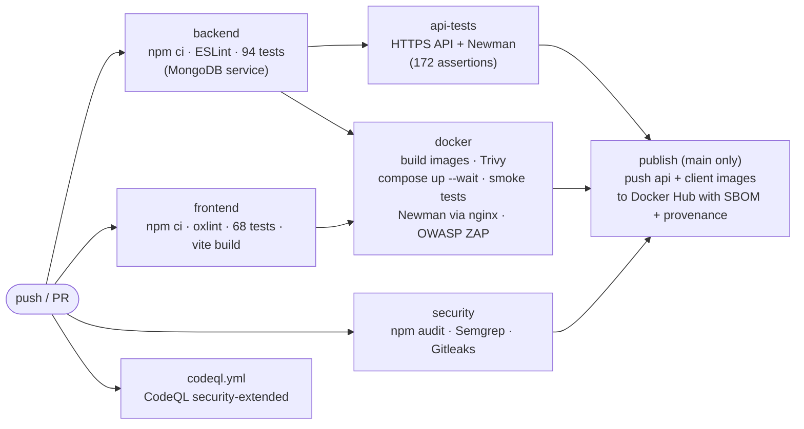

| Job | Steps | Fails when |
|---|---|---|
| **backend** | `npm ci`, **ESLint** (security + Node plugins), Vitest + Supertest against a MongoDB service container, JUnit + ESLint JSON artifacts | Any lint error or failing test |
| **frontend** | `npm ci`, **oxlint**, Vitest + Testing Library, **production build**, `dist/` artifact | Lint error, failing test or build error |
| **api-tests** | Random per-run secrets, TLS cert, seed admin, start the API over HTTPS, **Newman** (CLI + HTML + JUnit) | API not healthy or any assertion fails |
| **security** | **npm audit** (production deps, high+), **Semgrep** SAST (JavaScript, Node, Express, React, OWASP Top 10, secrets, Dockerfile, GitHub Actions), **Gitleaks** over the whole git history | Any high/critical vulnerability, Semgrep finding or leaked secret |
| **docker** | Build both images, **Trivy** image scan (fixable HIGH/CRITICAL), `docker compose up --wait`, **smoke tests** (health, SPA, CSP, HTTP→HTTPS, `/.env` → 404), seed admin in the container, **Newman through nginx**, **OWASP ZAP baseline** DAST, container logs + reports as artifacts | Image vulnerability, unhealthy container, failed smoke test or assertion, or a ZAP FAIL |
| **publish** (CD) | On `main` only, after **all** jobs pass: build and push `hustlehub-api` and `hustlehub-client` to Docker Hub as `:latest` and `:sha-<commit>`, with **SBOM and provenance** attestations | Any earlier job failed (it does not run) |
| **CodeQL** (`codeql.yml`) | Semantic data-flow analysis, `security-extended` queries; also weekly | Results appear under **Security → Code scanning** |

**Supply-chain hardening** (following GitHub's Actions security guidance [22]): least-privilege `permissions: contents: read`, every third-party action **pinned to a full commit SHA**, random secrets generated per run (nothing stored in the repo), and **Dependabot** weekly updates for npm, Docker base images and Actions with a 7-day cooldown.

**Configuring delivery:** repository **variable** `DOCKERHUB_USERNAME` (`evanildo1997`) and **secret** `DOCKERHUB_TOKEN` (a Docker Hub access token with Read & Write). Without the token the job prints a notice and the images are still built and tested.

Evidence: [Actions runs](https://github.com/evanildo26/hustlehub-plus-part3/actions) and the screenshot in §16.

---

## 14. Static Code Analysis and Security Scanning

### 14.1 Tools and results

| Tool | Type | Scope | First run | After fixes |
|---|---|---|---|---|
| **ESLint** + `eslint-plugin-security` + `eslint-plugin-n` | SAST / lint | API source, scripts, tests | 31 errors, 1 warning | **0** |
| **Semgrep** (155 community rules) [23] | SAST | All tracked code, nginx config, Dockerfiles, workflows | 2 findings (nginx), then 28 (workflows) | **0** |
| **CodeQL** (security-extended) [27] | Semantic SAST | API + client JavaScript (docs/ excluded) | 13 alerts | **0 open** (10 fixed, 3 reviewed false positives dismissed with reasons) |
| **oxlint** | Lint | Client | 1 warning | **0** |
| **npm audit** (`--omit=dev`) | Dependency scan | API + client production deps | 0 | **0** |
| **Trivy** [24] | Image scan | Both images | API: 1 CRITICAL + 10 HIGH; client: 40 HIGH | **0** fixable HIGH/CRITICAL |
| **Gitleaks** [26] | Secret scan | Whole git history | 0 leaks | **0** |
| **OWASP ZAP** baseline [25] | DAST | Running Docker stack | 0 FAIL, 5 WARN, 62 PASS | **0 FAIL, 0 WARN, 64 PASS** (3 documented ignores) |

### 14.2 What the results indicated and how they were fixed

| Finding | What it indicated | Fix |
|---|---|---|
| ESLint `security/detect-object-injection` (25) | Dynamic `obj[key]` access, the pattern behind prototype-pollution and property-injection bugs. Most keys came from constant allow-lists (false positives), but it showed that **request bodies could carry a `__proto__` key**. | **Real fix:** `sanitizeRequest` now strips `__proto__` / `constructor` / `prototype` at any depth and logs `PROTOTYPE_POLLUTION_ATTEMPT` (+2 tests). The other sites were refactored to `Map`, `Object.entries` filters and `Array.find`, so no dynamic indexing remains. |
| ESLint `security/detect-unsafe-regex` (1) | The price regex had nested quantifiers, a ReDoS pattern. | Replaced with two bounded checks (`isMoneyAmount`) and 7 tests. |
| ESLint `security/detect-non-literal-regexp` (1 + 2 in tests) | `new RegExp(userInput)` in gig search. | Reviewed: input is escaped and capped at 50 characters, so the match is literal and bounded. Justified inline suppression with the reason in the code; the same for the test that proves it. |
| ESLint `n/no-unsupported-features` (fetch) | The API uses `fetch` and `AbortSignal.timeout`, which aren't stable on Node 18. | `engines` raised to Node ≥ 22.12, matching Docker and CI. |
| ESLint config / stale directive (6) | Config-file and ESM parsing, an unused disable comment. | Config corrected; directive removed. |
| oxlint `set-state-in-effect` | Synchronous state update in an effect (extra render). | The refresh flag is set in the change handler instead. |
| Semgrep `request-host-used` (2) | nginx used the client-controlled `Host` header in the HTTP→HTTPS redirect (an **open-redirect** risk) and the upstream header. | Fixed `server_name localhost`, redirect to a fixed host, `proxy_set_header Host api`. |
| Semgrep `github-actions-mutable-action-tag` (23) | Actions referenced by movable tags (`@v4`): a hijacked tag would run attacker code in CI. | Every action pinned to a **full commit SHA**, with the version in a comment. |
| Semgrep `dependabot-missing-cooldown` (5) | Dependabot would propose a brand-new (possibly malicious) release immediately. | `cooldown: { default-days: 7 }` on every ecosystem. |
| Trivy: `proxy-addr@2.0.7` **CRITICAL** | IP spoofing via IPv4-mapped IPv6, directly relevant now that `trust proxy` is on. | Updated to 2.0.8. |
| Trivy: npm CLI inside the Node image (10 HIGH) | The base image ships npm with vulnerable dependencies the API never uses. | npm, npx, corepack and yarn removed from the runtime image. |
| Trivy: Alpine packages in the nginx image (40 HIGH) | curl, expat, pcre2, libxml2, tiff etc. were behind on patches. | `apk upgrade` at build time; rescanned clean. |
| ZAP 90004 (COEP) | The page didn't isolate itself from cross-origin resources. | `Cross-Origin-Embedder-Policy: require-corp` and `Cross-Origin-Resource-Policy: same-origin`. |
| ZAP 10015 (cache) | HTML and small files lacked strict cache directives; unknown `.txt`/`.xml` paths returned the app's HTML. | `no-cache, no-store, must-revalidate`; a real `robots.txt`; unknown file paths return `404` (e.g. `/.env`). |
| ZAP 10049 / 10027 / 10109 | Cacheable fingerprinted assets (intended), words in third-party minified code, "modern web app" (informational). | Reviewed and recorded as IGNORE with reasons in `.zap/rules.tsv`. |
| CodeQL `js/sql-injection` (3) | Query objects built from request values (gig id, category, prices). They were validated, but the code didn't *prove* they couldn't be objects. | `{ $eq: value }` and `Number()`, so each value is always a literal, never an operator. |
| CodeQL `js/incomplete-multi-character-sanitization` (1) | One pass of tag removal turns `<scr<script>ipt>` into `<script>` (the later bracket strip happened to catch it). | Tag removal repeats until the text stops changing (+ test). |
| CodeQL `js/file-system-race` (1) | `generateCert.js` checked for the files, then wrote them later. | Files created atomically with the `wx` flag; the private key is written `0600`. |
| CodeQL `js/functionality-from-untrusted-source` (5) | The Newman HTML *evidence* report loads its viewer from a CDN. | Not application code: `docs/` excluded via `.github/codeql/codeql-config.yml`. |
| CodeQL `js/user-controlled-bypass` (2), `js/file-access-to-http` (1) | (a) The Bearer-header format check; (b) the health check passes the server's own certificate as its CA. | Reviewed **false positives** and dismissed with written reasons: (a) the check can only *reject*, and a valid-looking header still gets full verification; (b) the file is a public certificate used to verify TLS to 127.0.0.1 and is not sent. |
| Build: font inlined as `data:` URL | A CSP violation (`font-src 'self'`) found by a browser check of the production build. | `assetsInlineLimit: 0` in `vite.config.js`. |
| UI: hidden table labels widened the page on phones | Accessibility labels escaped their scroll container. | `.table-wrap { position: relative }`. |

**Conclusion:** no unresolved security finding remains. Every result was either fixed in code or configuration (and the pipeline now enforces it) or reviewed and documented with its reason. Raw outputs are in [`docs/evidence/part3/`](docs/evidence/part3).

---

## 15. Final Security Review

How HustleHub+ addresses common threats, mapped to the OWASP Top 10 (2021) [3].

| Threat | Where it could happen | Controls in place | Verified by |
|---|---|---|---|
| **Injection (A03)**: NoSQL operator injection | Login, filters, any JSON body | `$`/dotted keys stripped before routing (logged); validators require strings; Mongoose `strictQuery`; queries built from validated values only | Tests and Newman `{"email":{"$ne":null}}` → 400; Security monitor |
| Injection: ReDoS / regex | Search, price | Search input escaped + 50-char cap; price checked without nested quantifiers | Tests; ESLint `detect-unsafe-regex` in CI |
| Injection: prototype pollution | Any JSON body | `__proto__`/`constructor`/`prototype` stripped and logged | Tests; Newman folder 8 |
| **Cross-site scripting (A03)** | Gig titles/descriptions, booking notes, names | Server strips HTML and angle brackets before storage; React escapes all output; no `dangerouslySetInnerHTML`; **CSP `script-src 'self'`**, no inline scripts, `object-src 'none'`; fonts and icons self-hosted | `GigCard` test (markup rendered as text); Newman XSS cases; ZAP; browser run with 0 CSP violations |
| **Authentication weaknesses (A07)**: brute force / stuffing | Login | Per-IP failed-login limiter **+ per-account lockout** (423) + `SECURITY_ALERT` | Tests; Newman lockout loop; alert test |
| Account enumeration | Login, lockout | Same message and timing for unknown email and wrong password; lockout keyed by typed email | Tests (identical responses) |
| Weak or stolen tokens | Every protected route | HS256 pinned, `iss`/`aud`/`exp`, 32+ char secret, **logout deny-list**, **admin revocation**, `jti` required, role from DB | Tests (forged, `alg:none`, logged-out, revoked, no-`jti`) |
| Weak passwords | Registration | 8+ chars, upper, lower, number, symbol; bcrypt cost 12 | Tests; frontend checklist |
| **Broken access control (A01)**: wrong role | Gigs, bookings, income, tax, admin | `restrictTo` on every route; the UI hides links for usability only | Tests + Newman 403s; `ACCESS_DENIED` logs |
| IDOR / other users' data | `/:id` routes, lists, income, tax | Ownership checks; lists and aggregations filtered by caller id in the query | Tests (outsider 403, other freelancer R0) |
| Mass assignment | Gig and booking bodies | Field allow-lists (`400`); owner and price from token/DB, never from the body | Tests + Newman (`amount`, `freelancer`, `isAdmin`) |
| **Cryptographic failures (A02)** | Transport, storage | HTTPS everywhere incl. nginx → API with **verified** TLS; HSTS; bcrypt; `no-store` on personal data | Smoke tests (redirect), headers in Newman/ZAP |
| **Security misconfiguration (A05)** | Headers, errors, containers | Helmet + strict CSP, COEP/CORP, no stack traces, `server_tokens off`, non-root read-only containers, internal DB network, no published API/DB ports | ZAP 0 FAIL/0 WARN; Trivy; compose config |
| **Vulnerable components (A06)** | npm packages, base images, Actions | npm audit, Trivy, Dependabot (7-day cooldown), SHA-pinned Actions | CI `security` and `docker` jobs |
| **Software and data integrity (A08)** | CI/CD, financial records | Pinned Actions, least-privilege workflow permissions, SBOM + provenance on images; append-only transactions | Semgrep workflow rules; pipeline |
| **Logging and monitoring failures (A09)** | Whole system | Structured, redacted logs with request ids; cloud logging; Security monitor; automatic alerts | Logging tests; Better Stack evidence |
| **SSRF (A10)** | — | The API makes no requests based on user input; its only outbound call is to the fixed Better Stack host | Code review |
| Denial of service | API | Rate limits (API + nginx), 10 kB body cap (nginx 16 kB), bounded queries (`limit`), bounded log queue | Tests (413, 429) |
| Secrets exposure | Repo, images, logs | `.env` git-ignored and in `.dockerignore`; random CI secrets; Gitleaks; log redaction | Gitleaks in CI; redaction test |
| CSRF | State-changing requests | No cookies: the JWT is sent only as a Bearer header (`credentials: 'omit'`), so a forged cross-site request carries no credentials | Design |

**Residual risks (accepted for a student project):** self-signed certificates (production would use a CA-issued certificate); the token in `sessionStorage` is readable by page scripts (mitigated by CSP, escaping and short expiry); the lockout and alert windows are in memory or MongoDB for a single API instance (several instances would share Redis); payments are simulated.

---

## 16. Demonstration Evidence

### 16.1 Part 3 screenshots ([`docs/screenshots/part3`](docs/screenshots/part3))

| | |
|---|---|
| Earnings & tax dashboard 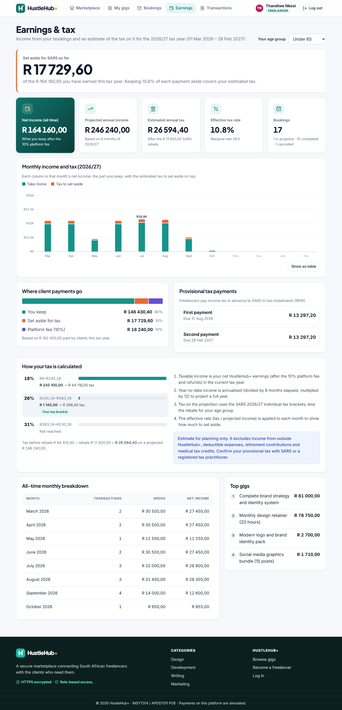 | Monthly income vs tax, with tooltip 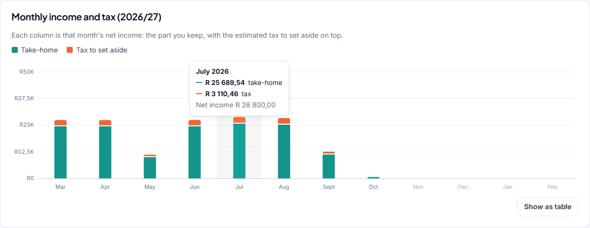 |
| How the tax is calculated 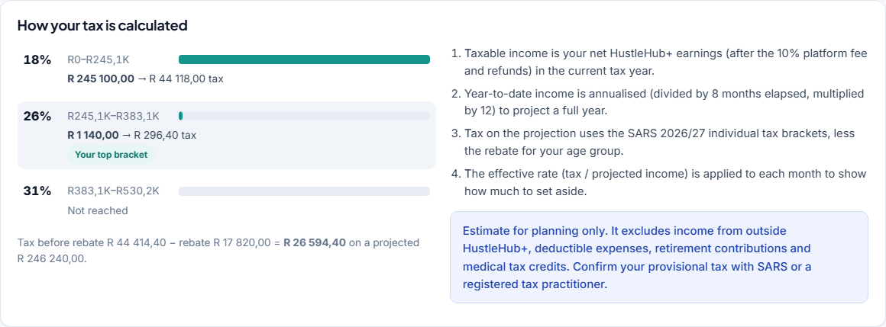 | Where payments go + provisional tax 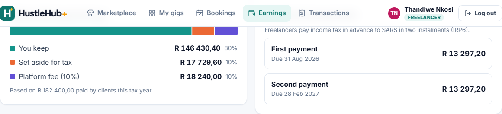 |
| Account lockout (423) 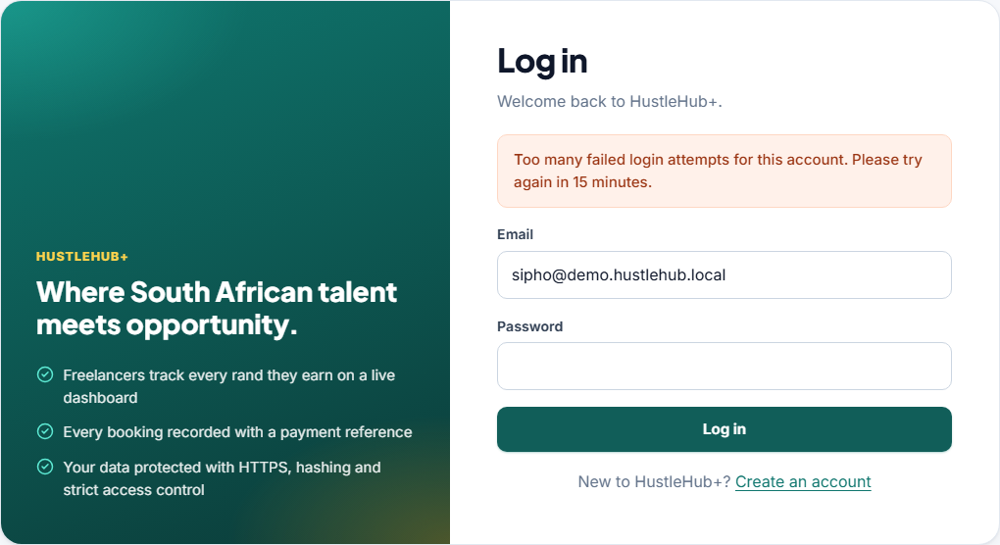 | Admin Security monitor with alerts 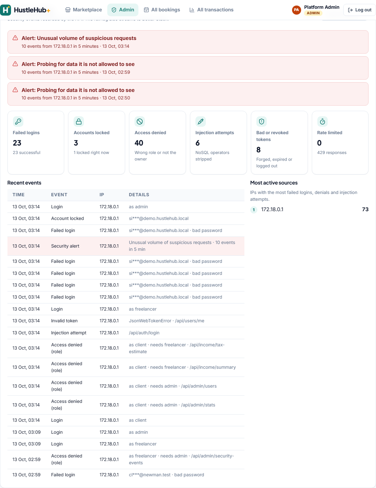 |
| Admin revokes a user's sessions 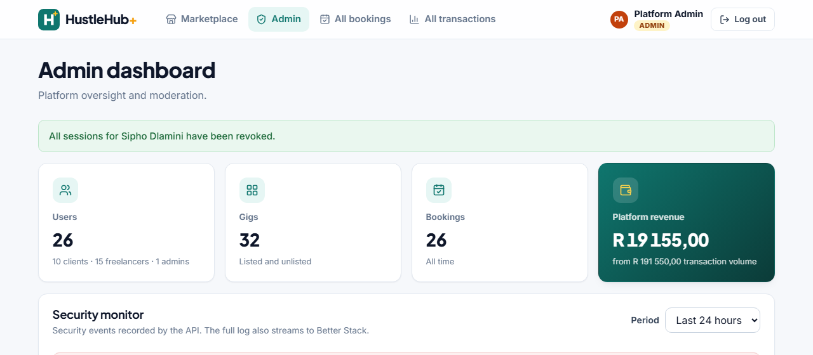 | Dashboard on a phone 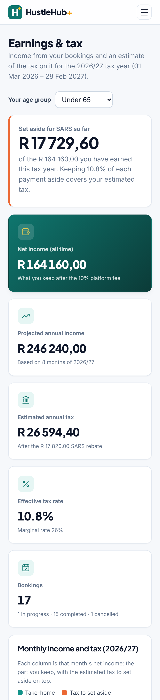 |
| Cloud logs in Better Stack (Live tail)  | GitHub Actions pipeline, all jobs green 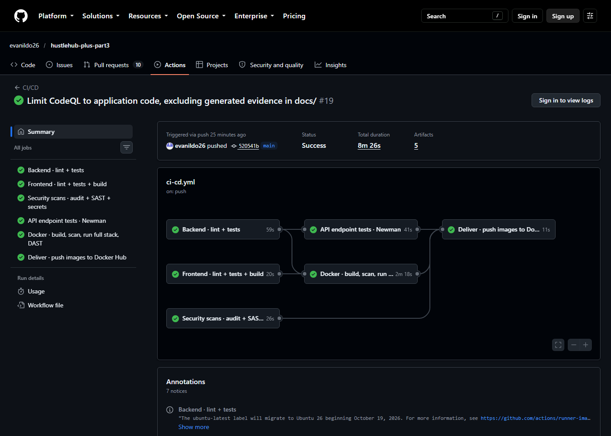 |

Pipeline, Docker, scanning and logging evidence:

| Evidence | File |
|---|---|
| GitHub Actions run (all jobs green) | `docs/screenshots/part3/09-github-actions-pipeline.png` |
| Containers running and healthy | `docs/screenshots/part3/10-docker-compose-running.png`, `docs/evidence/part3/docker-compose-ps.txt` |
| Better Stack Live tail (cloud logging) | `docs/screenshots/part3/11-better-stack-logs.png` |
| CodeQL results (13 alerts: 10 fixed, 3 reviewed and dismissed, 0 open) | `docs/evidence/part3/codeql-alerts.txt` and the repository Security → Code scanning tab |
| Newman (Docker stack) | `docs/evidence/part3/newman-report.html`, `newman-cli-output.txt` |
| OWASP ZAP report | `docs/evidence/part3/zap-report.html` |
| Semgrep (SARIF, 0 results), Gitleaks (0 leaks), ESLint (0 problems) | `semgrep-results.sarif`, `gitleaks-report.json`, `eslint-output.txt` in `docs/evidence/part3/` |
| Newman inside CI (API job and Docker job) | `newman-report-ci-api.html`, `newman-report-ci-docker.html` |
| Containers and logs inside CI | `ci-docker-compose-ps.txt`, `ci-api-events.log` |
| Test outputs | `docs/evidence/part3/backend-tests-output.txt`, `frontend-tests-output.txt` |
| Log sample from the API container | `docs/evidence/part3/api-events-log-sample.txt` |

Part 1 and Part 2 evidence remains in `docs/screenshots/part1`, `docs/screenshots/part2` and `docs/evidence/`.

---

## 17. Known Limitations

- **Tax is an estimate:** individual tables only; no other income, expenses, retirement or medical credits; turnover tax (SA's alternative for micro-businesses) not modelled.
- **Single-node state:** the in-memory rate limiters and alert windows assume one API instance (Redis would share them across replicas).
- **No multi-document transactions:** standalone MongoDB; `bookingService` rolls back manually if recording a payment fails (a replica set would allow ACID transactions).
- **Self-signed certificates** locally and in Docker; a real deployment would mount a CA-issued certificate into nginx and set its own domain in `server_name`.
- **Delivery, not deployment:** the pipeline publishes tested images to Docker Hub. Running them on a cloud host would be the next step.
- **Dev-only advisories:** `npm audit --omit=dev` is clean. Remaining advisories are in dev tooling (Newman and its reporter, the certificate generator) that never ships in an image.

---

## 18. References

[1] OWASP Foundation, "Password Storage Cheat Sheet," *OWASP Cheat Sheet Series*, 2023. [Online]. Available: https://cheatsheetseries.owasp.org/cheatsheets/Password_Storage_Cheat_Sheet.html. [Accessed: 27-Jul-2026].

[2] M. Jones, J. Bradley, and N. Sakimura, "JSON Web Token (JWT)," RFC 7519, Internet Engineering Task Force (IETF), May 2015. [Online]. Available: https://www.rfc-editor.org/rfc/rfc7519. [Accessed: 27-Jul-2026].

[3] OWASP Foundation, "OWASP Top Ten," *OWASP*, 2021. [Online]. Available: https://owasp.org/www-project-top-ten/. [Accessed: 27-Jul-2026].

[4] OWASP Foundation, "Input Validation Cheat Sheet," *OWASP Cheat Sheet Series*, 2023. [Online]. Available: https://cheatsheetseries.owasp.org/cheatsheets/Input_Validation_Cheat_Sheet.html. [Accessed: 27-Jul-2026].

[5] OpenJS Foundation, "Express — Node.js Web Application Framework," *Express.js Documentation*, 2024. [Online]. Available: https://expressjs.com/. [Accessed: 27-Jul-2026].

[6] Mozilla Developer Network, "HTTP Strict Transport Security (HSTS)," *MDN Web Docs*, 2024. [Online]. Available: https://developer.mozilla.org/en-US/docs/Web/HTTP/Headers/Strict-Transport-Security. [Accessed: 27-Jul-2026].

[7] Node.js Foundation, "HTTPS," *Node.js Documentation*, 2024. [Online]. Available: https://nodejs.org/api/https.html. [Accessed: 27-Jul-2026].

[8] Helmet.js, "Helmet Documentation," 2024. [Online]. Available: https://helmetjs.github.io/. [Accessed: 27-Jul-2026].

[9] OWASP Foundation, "Insecure Direct Object Reference Prevention Cheat Sheet," *OWASP Cheat Sheet Series*, 2023. [Online]. Available: https://cheatsheetseries.owasp.org/cheatsheets/Insecure_Direct_Object_Reference_Prevention_Cheat_Sheet.html. [Accessed: 05-Oct-2026].

[10] OWASP Foundation, "Testing for NoSQL Injection," *OWASP Web Security Testing Guide*, 2023. [Online]. Available: https://owasp.org/www-project-web-security-testing-guide/latest/4-Web_Application_Security_Testing/07-Input_Validation_Testing/05.6-Testing_for_NoSQL_Injection. [Accessed: 05-Oct-2026].

[11] Mozilla Developer Network, "Content Security Policy (CSP)," *MDN Web Docs*, 2025. [Online]. Available: https://developer.mozilla.org/en-US/docs/Web/HTTP/CSP. [Accessed: 05-Oct-2026].

[12] OWASP Foundation, "Cross Site Scripting Prevention Cheat Sheet," *OWASP Cheat Sheet Series*, 2023. [Online]. Available: https://cheatsheetseries.owasp.org/cheatsheets/Cross_Site_Scripting_Prevention_Cheat_Sheet.html. [Accessed: 05-Oct-2026].

[13] Mongoose, "Mongoose ODM Documentation," 2025. [Online]. Available: https://mongoosejs.com/docs/. [Accessed: 05-Oct-2026].

[14] Meta Open Source, "React Documentation," 2025. [Online]. Available: https://react.dev/. [Accessed: 05-Oct-2026].

[15] N. Freeman, "express-rate-limit Documentation," 2025. [Online]. Available: https://express-rate-limit.mintlify.app/. [Accessed: 05-Oct-2026].

[16] Postman, Inc., "Run collections using Newman CLI," *Postman Docs*, 2025. [Online]. Available: https://learning.postman.com/docs/collections/using-newman-cli/command-line-integration-with-newman/. [Accessed: 05-Oct-2026].

[17] Testing Library, "React Testing Library," 2025. [Online]. Available: https://testing-library.com/docs/react-testing-library/intro/. [Accessed: 05-Oct-2026].

[18] OWASP Foundation, "Mass Assignment Cheat Sheet," *OWASP Cheat Sheet Series*, 2023. [Online]. Available: https://cheatsheetseries.owasp.org/cheatsheets/Mass_Assignment_Cheat_Sheet.html. [Accessed: 05-Oct-2026].

[19] South African Revenue Service, "Rates of Tax for Individuals," *SARS*, 2026. [Online]. Available: https://www.sars.gov.za/tax-rates/income-tax/rates-of-tax-for-individuals/. [Accessed: 13-Oct-2026].

[20] OWASP Foundation, "Logging Cheat Sheet," *OWASP Cheat Sheet Series*, 2024. [Online]. Available: https://cheatsheetseries.owasp.org/cheatsheets/Logging_Cheat_Sheet.html. [Accessed: 13-Oct-2026].

[21] OWASP Foundation, "Docker Security Cheat Sheet," *OWASP Cheat Sheet Series*, 2024. [Online]. Available: https://cheatsheetseries.owasp.org/cheatsheets/Docker_Security_Cheat_Sheet.html. [Accessed: 13-Oct-2026].

[22] GitHub, Inc., "Security hardening for GitHub Actions," *GitHub Docs*, 2026. [Online]. Available: https://docs.github.com/en/actions/security-for-github-actions/security-guides/security-hardening-for-github-actions. [Accessed: 13-Oct-2026].

[23] Semgrep, Inc., "Semgrep Documentation," 2026. [Online]. Available: https://semgrep.dev/docs/. [Accessed: 13-Oct-2026].

[24] Aqua Security, "Trivy Documentation," 2026. [Online]. Available: https://trivy.dev/latest/docs/. [Accessed: 13-Oct-2026].

[25] ZAP Dev Team, "ZAP Baseline Scan," *ZAP Documentation*, 2026. [Online]. Available: https://www.zaproxy.org/docs/docker/baseline-scan/. [Accessed: 13-Oct-2026].

[26] Gitleaks, "Gitleaks — Find secrets with Gitleaks," *GitHub*, 2026. [Online]. Available: https://github.com/gitleaks/gitleaks. [Accessed: 13-Oct-2026].

[27] GitHub, Inc., "About code scanning with CodeQL," *GitHub Docs*, 2026. [Online]. Available: https://docs.github.com/en/code-security/code-scanning/introduction-to-code-scanning/about-code-scanning-with-codeql. [Accessed: 13-Oct-2026].

[28] Better Stack, "Ingesting logs over HTTP," *Better Stack Docs*, 2026. [Online]. Available: https://betterstack.com/docs/logs/ingesting-data/http/logs/. [Accessed: 13-Oct-2026].

[29] Docker, Inc., "Docker Compose Documentation," 2026. [Online]. Available: https://docs.docker.com/compose/. [Accessed: 13-Oct-2026].

[30] OWASP Foundation, "Authentication Cheat Sheet," *OWASP Cheat Sheet Series*, 2024. [Online]. Available: https://cheatsheetseries.owasp.org/cheatsheets/Authentication_Cheat_Sheet.html. [Accessed: 13-Oct-2026].

[31] OWASP Foundation, "Prototype Pollution Prevention Cheat Sheet," *OWASP Cheat Sheet Series*, 2024. [Online]. Available: https://cheatsheetseries.owasp.org/cheatsheets/Prototype_Pollution_Prevention_Cheat_Sheet.html. [Accessed: 13-Oct-2026].
