# HustleHub+ — Secure Stack (Part 2)

**Module:** Information Systems 3D (INSY7314/w) / Application Development Security (APDS7311/w)
**POE Part:** 2 of 3 — Secure Stack
**Student:** Evanildo Julio Chaves Jose (ST10437401) — Group Leader
**Student:** Mohamed Ahmed (ST10448258)
**Student:** Tawfeeq Gallie (ST10434369)
**Student:** Fay-yaad Parker (ST10434066)
**GitHub:** [evanildo26](https://github.com/evanildo26)
**Stack:** MERN — **M**ongoDB · **E**xpress · **R**eact · **N**ode.js (all four layers are now implemented)

| Demonstration video | Link |
|---|---|
| Part 2 — full application flow | _add YouTube link here_ |
| Part 1 — secure backend foundations | https://www.youtube.com/watch?v=HqpkX3bnkW0 |

---

## Table of Contents

1. [Project Overview](#1-project-overview)
2. [What Changed Since Part 1](#2-what-changed-since-part-1)
3. [Architecture](#3-architecture)
4. [Features by Role](#4-features-by-role)
5. [Project Structure](#5-project-structure)
6. [Security Implementation](#6-security-implementation)
7. [Getting Started](#7-getting-started)
8. [API Reference](#8-api-reference)
9. [Testing](#9-testing)
10. [Screenshots](#10-screenshots)
11. [Known Limitations and Part 3 Plan](#11-known-limitations-and-part-3-plan)
12. [References](#12-references)

---

## 1. Project Overview

HustleHub+ is a freelance marketplace. **Freelancers** advertise services ("gigs"), **clients** browse and book them, and every booking produces a **transaction record** so freelancers can track the income they have earned. **Admins** oversee the platform.

| Role | What they can do |
|---|---|
| **Client** | Browse and search gigs, book gigs (simulated payment), view and cancel their own bookings, view their payment history. |
| **Freelancer** | Create, edit, list/unlist and delete their **own** gigs, view bookings made on their gigs, mark bookings completed, track income and view their transactions. |
| **Admin** | View platform statistics, list all users, view all bookings and transactions (read-only), and remove any gig (moderation). Admins cannot self-register; the account is provisioned by a seed script. |

The platform handles credentials, personal data and financial records, so security has been designed in from Part 1 onwards rather than added at the end.

---

## 2. What Changed Since Part 1

| Area | Part 1 | Part 2 |
|---|---|---|
| Data storage | JSON file (`users.json`) | **MongoDB** via Mongoose: `User`, `Gig`, `Booking`, `Transaction` models with schema validation and indexes |
| Frontend | None | **React 19** single-page app (Vite) with a responsive, role-aware design for all three roles |
| Features | Register, login, `/users/me` | **Gig management**, **browsing/search**, **bookings with simulated payment**, **transactions**, **income summary**, **admin dashboard** |
| Authorisation | `restrictTo` helper prepared but unused | **RBAC enforced on every route**, plus **ownership checks** (users can't touch resources that aren't theirs) |
| Validation | express-validator on auth fields | Validation **and sanitisation** on every input; **NoSQL-injection guard**; **mass-assignment allow-lists**; regex-safe search |
| Rate limiting | One generous limiter on auth | Separate **login** (failed attempts only), **register**, **booking** (per user) and **global** limiters with meaningful `429` responses |
| Security headers | Helmet defaults | Explicit Helmet config with a **strict CSP** on the API, plus a **CSP for the React app** (strict in production builds) |
| JWT | HS256 with expiry | Also **pins the algorithm** and enforces **issuer/audience** claims; the role is re-read from the database on each request |
| Testing | Manual Postman collection | **54 backend tests** (Vitest + Supertest), **Newman** run of a 66-request / 130-assertion collection, **53 frontend tests** (Vitest + Testing Library) |
| Logging | Auth events | Adds gig, booking, transaction, access-denied, ownership-violation, NoSQL-injection and rate-limit events |
| Repo layout | Backend at the root | `api/` (Express) and `client/` (React), ready for one Dockerfile per folder in Part 3 |
| Demo data | Manual registration | `npm run seed:demo` creates 9 freelancers, **27 gigs** across all 8 categories, 2 clients and sample bookings with real transaction records |

---

## 3. Architecture

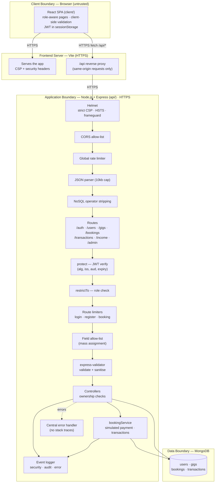

**Request flow, using "client books a gig" as the example:**

1. The React page validates the notes field (max 500 chars, no `<` `>`), then calls `POST /api/bookings` with the Bearer token.
2. Vite proxies the request (same origin, so the CSP can use `connect-src 'self'`) to the Express API over HTTPS.
3. Helmet adds security headers, CORS checks the origin, the global limiter checks the IP's budget, the body is size-capped and parsed, and any `$`-operator keys are stripped.
4. `protect` verifies the JWT (signature, `HS256` only, issuer, audience, expiry) and reloads the user from MongoDB, so the role is current.
5. `restrictTo('client')` rejects anyone who isn't a client (`403`), and `bookingLimiter` caps bookings per user.
6. `allowOnlyFields` rejects unexpected fields such as `amount`, then express-validator checks `gigId` is an ObjectId and strips markup from `notes`.
7. `bookingService` loads the gig, takes the price **from the database**, simulates the payment, creates the booking and records a `payment` transaction (90% freelancer / 10% platform). It writes `BOOKING_CREATED` and `TRANSACTION_RECORDED` audit logs.
8. The client receives the confirmation with the payment and transaction references. Any error is turned into a safe JSON message by the central handler.

**Trust boundaries:** the browser is untrusted, and everything it sends is re-validated by the API. Client-side checks exist only for usability. The API is the security boundary. Only the model layer talks to MongoDB, and the database itself enforces a second layer of rules (schema validation, unique email index).

---

## 4. Features by Role

**Client**
- Browse the marketplace from a landing page with keyword search, popular-search shortcuts, **category chips with live gig counts** and pagination.
- View gig details and **book** with optional notes. Payment is simulated and returns a `SIM-PAY-…` reference and a `TXN-…` transaction reference.
- **My bookings**: status (confirmed / completed / cancelled), the option to cancel a confirmed booking (which records a refund).
- **Payments**: read-only history of payments and refunds.

**Freelancer**
- **My gigs**: create, edit, list/unlist and delete own gigs. Deleting a gig with confirmed bookings is blocked (`409`) so a paid booking is never stranded.
- **Bookings**: see who booked which gig, mark bookings **completed** or cancel them.
- **Earnings**: net income, gross bookings, platform fees, booking counts, a monthly breakdown and top gigs. All of it is computed server-side from the freelancer's own transactions.
- **Transactions**: full history including the fee split.

**Admin**
- **Dashboard**: user counts by role, gig and booking totals, transaction volume and platform revenue.
- **Gig moderation**: remove any gig.
- **Users**: list all accounts (password hashes are never included).
- Read-only view of **all bookings** and **all transactions**.

**How transactions and income work:** each booking creates one `payment` transaction (`amount`, `platformFee` = 10%, `freelancerEarnings` = 90%). Cancelling creates a matching `refund` transaction with negative amounts. Records are **append-only**: nothing is ever edited or deleted, so a freelancer's income is simply the sum of their transaction rows and the history stays auditable. The booking also stores a **snapshot** of the gig title and price, so later edits to the gig can't change what a client paid.

---

## 5. Project Structure

```
hustlehub-backend/
├── api/                                # Express + MongoDB backend
│   ├── server.js                       # HTTPS bootstrap: loads cert, connects to MongoDB, starts server
│   ├── scripts/
│   │   ├── generateCert.js             # Local self-signed TLS certificate
│   │   ├── seedAdmin.js                # Creates the admin account from .env
│   │   ├── seedDemo.js                 # 9 freelancers, 27 gigs, 2 clients, sample bookings
│   │   └── runNewman.js                # Runs the Postman collection with Newman (+ HTML/JUnit reports)
│   ├── src/
│   │   ├── app.js                      # Middleware order + route wiring
│   │   ├── config/  env.js · db.js     # Env loading (fail-fast) · Mongoose connection
│   │   ├── models/                     # userModel · gigModel · bookingModel · transactionModel
│   │   ├── routes/                     # auth · user · gig · booking · transaction · admin
│   │   ├── controllers/                # Thin handlers + ownership checks
│   │   ├── services/bookingService.js  # Booking, simulated payment, transactions, refunds
│   │   ├── middleware/
│   │   │   ├── authMiddleware.js       # protect (JWT) · restrictTo (RBAC) · optionalAuth
│   │   │   ├── securityHeaders.js      # Helmet + strict CSP · no-store caching
│   │   │   ├── rateLimiter.js          # login · register · booking · global limiters
│   │   │   ├── sanitizeRequest.js      # NoSQL-injection guard
│   │   │   ├── errorHandler.js         # 404 + central safe error responses
│   │   │   └── validators/             # common · auth · gig · booking rules
│   │   ├── utils/                      # AppError · jwt · logger · sanitize
│   │   └── logs/events.log             # Runtime event log (git-ignored)
│   ├── tests/                          # Vitest + Supertest integration tests
│   └── postman/
│       ├── HustleHub-Part1.postman_collection.json
│       ├── HustleHub-Part2.postman_collection.json
│       └── reports/                    # Newman output (git-ignored; copies in docs/evidence)
├── client/                             # React frontend (Vite)
│   ├── vite.config.js                  # HTTPS, /api proxy, CSP + security headers, test config
│   └── src/
│       ├── api/client.js               # Single fetch wrapper (token, safe errors, 401 handling)
│       ├── context/AuthContext.jsx     # Session state (sessionStorage, re-validated on load)
│       ├── components/                 # NavBar, Footer, AuthLayout, GigCard, GigForm, StatCard, Avatar, ...
│       ├── pages/                      # Gigs, GigDetail, Login, Register, MyGigs, GigEditor,
│       │                               # Bookings, Transactions, Earnings, Admin, NotFound
│       ├── utils/                      # validation (mirrors API rules) · format (ZAR, dates) · categories
│       └── tests/                      # Vitest + Testing Library component tests
└── docs/
    ├── screenshots/part1 · part2/
    └── evidence/                       # Newman report + test outputs
```

**Why this layout:** routes say *which* URL maps to *which* middleware chain. Middleware holds cross-cutting security concerns. Controllers stay thin and enforce ownership. `bookingService` holds the multi-step money logic. Models are the only code that touches MongoDB. Because of this separation, Part 1's file store could be swapped for MongoDB without changing the shape of any route, and every new route reuses the same `protect` / `restrictTo` / validator building blocks, following Express's middleware-chain model [5].

---

## 6. Security Implementation

### 6.1 Authentication: Password Hashing and JWT

- **bcrypt (cost 12)** hashes passwords before storage. The hash field is `select: false` in the schema, so it is excluded from every query unless login explicitly asks for it, and the `toJSON` transform strips it as a second safeguard [1].
- **Timing-safe login:** when an email isn't registered, the server still runs a bcrypt comparison against a dummy hash. Both failure cases take the same time and return the same generic `401`, so attackers can't discover which emails have accounts [1][3].
- **JWT hardening:** tokens carry only `id`, `role` and `email`, expire after one hour, and are verified with `algorithms: ['HS256']` (blocking `alg: none` and algorithm-confusion attacks), `issuer` and `audience` [2]. `JWT_SECRET` must be at least 32 characters or the server refuses to start.
- **Role from the database, not the token:** `protect` reloads the user on every request, so a deleted account or a role change takes effect immediately.
- **HTTPS everywhere:** both the API and the React dev/preview server run over HTTPS using the locally generated certificate. HSTS tells browsers to refuse plain HTTP for a year [6][7].

### 6.2 Role-Based Access Control and Ownership

Access is enforced **in two layers** on the server:

1. **Role**: `restrictTo(...)` decides *who* may call an endpoint at all.
2. **Ownership**: controllers check that the specific record belongs to the caller. Without this, a freelancer could edit another freelancer's gig just by changing the id in the URL. That flaw is an **IDOR** (Insecure Direct Object Reference), part of OWASP's #1 risk, Broken Access Control [3][9]. Violations return `403` and are logged as `OWNERSHIP_VIOLATION`.

List endpoints are **scoped by the caller's id in the database query itself** (for example `{ client: req.user.id }`), so other users' bookings or transactions can never appear in a response.

| Endpoint | Anonymous | Client | Freelancer | Admin |
|---|:-:|:-:|:-:|:-:|
| `GET /api/gigs`, `GET /api/gigs/:id` | ✅ | ✅ | ✅ | ✅ |
| `POST /api/gigs` | ❌ 401 | ❌ 403 | ✅ | ❌ 403 |
| `PATCH /api/gigs/:id` | ❌ | ❌ | ✅ own only | ❌ |
| `DELETE /api/gigs/:id` | ❌ | ❌ | ✅ own only | ✅ any (moderation) |
| `GET /api/gigs/mine` | ❌ | ❌ | ✅ | ❌ |
| `POST /api/bookings` | ❌ | ✅ | ❌ | ❌ |
| `GET /api/bookings`, `/:id` | ❌ | ✅ own | ✅ on own gigs | ✅ all (read-only) |
| `PATCH /api/bookings/:id/complete` | ❌ | ❌ | ✅ own bookings | ❌ |
| `PATCH /api/bookings/:id/cancel` | ❌ | ✅ own | ✅ own bookings | ❌ |
| `GET /api/transactions` | ❌ | ✅ own | ✅ own | ✅ all |
| `GET /api/income/summary` | ❌ | ❌ | ✅ own | ❌ |
| `GET /api/admin/*` | ❌ | ❌ | ❌ | ✅ |

The React app mirrors these rules (role-aware navigation, `ProtectedRoute`) **purely for usability**. Hiding a page in the browser is not security; the API checks above are the actual enforcement.

### 6.3 Input Validation and Sanitisation

| Threat | Control | Where |
|---|---|---|
| **NoSQL injection** (e.g. `{"email": {"$ne": null}}` to bypass login) | `sanitizeRequest` strips every `$`-prefixed or dotted key from body, query and params at any depth and logs `NOSQL_INJECTION_ATTEMPT`. Validators also require fields to be **strings** (`isString`), and Mongoose `strictQuery` drops unknown filter fields [10][13]. | `middleware/sanitizeRequest.js`, validators |
| **Stored XSS** | Free-text fields (gig title/description, booking notes) pass through `sanitizeText`, which strips HTML tags, angle brackets and control characters **before** length checks. React escapes everything it renders, and the app never uses `dangerouslySetInnerHTML` [12][14]. | `utils/sanitize.js`, `GigCard` test |
| **Mass assignment** (e.g. sending `"freelancer": "<other id>"`, `"amount": 1` or `"isAdmin": true`) | `allowOnlyFields` rejects any body field that isn't on the endpoint's allow-list (`400`). Controllers also copy only allow-listed fields, and owners and amounts come from the token and the database, never the body [18]. | `validators/common.js` |
| **Regex injection / ReDoS** in search | User search text is escaped (`escapeRegex`) and capped at 50 characters, so `.*` is matched literally. | `gigController.listGigs` |
| **Invalid data** | Type, range and format rules: ObjectId params, price 50–100 000 with at most 2 decimals, delivery 1–90 days, category allow-list, password policy, and Mongoose schema validation as a second layer [4]. | `validators/*`, `models/*` |
| **Oversized payloads** | JSON body capped at 10 kb (`413`). | `app.js` |

### 6.4 Rate Limiting

| Limiter | Applies to | Default limit | Keyed by | Notes |
|---|---|---|---|---|
| `loginLimiter` | `POST /api/auth/login` | 10 **failed** attempts / 15 min | IP | Only `401` responses count, so legitimate users aren't locked out; brute-force and credential stuffing are slowed down. |
| `registerLimiter` | `POST /api/auth/register` | 20 accounts / 15 min | IP | Only successful sign-ups count (stops mass fake accounts). |
| `bookingLimiter` | `POST /api/bookings` | 10 bookings / 15 min | **User id** | Per-account, so changing IP doesn't help and shared networks aren't penalised. |
| `apiLimiter` | All `/api/*` | 300 requests / 15 min | IP | Ceiling against scraping/flooding. |

When a limit is exceeded the API returns **`429`** with a clear message, a `Retry-After` header and `retryAfterSeconds`, for example:

```json
{ "success": false, "message": "Too many failed login attempts. Please wait 15 minutes before trying again.", "retryAfterSeconds": 900 }
```

Every response also carries standard `RateLimit` / `RateLimit-Policy` headers so clients can see their remaining budget [15]. The React app shows the 429 message to the user. All limits are configurable in `.env`, and each hit is logged as `RATE_LIMIT_EXCEEDED`.

### 6.5 Security Headers and Content Security Policy

**API (Helmet):** the API only returns JSON, so it uses the strictest possible policy [8][11]:

```
Content-Security-Policy: default-src 'none'; frame-ancestors 'none'; base-uri 'none'; form-action 'none'
Strict-Transport-Security: max-age=31536000; includeSubDomains
X-Frame-Options: DENY · X-Content-Type-Options: nosniff · Referrer-Policy: no-referrer
Cross-Origin-Resource-Policy: same-site · Cache-Control: no-store   (X-Powered-By removed)
```

`Cache-Control: no-store` prevents personal and financial responses being cached by browsers or proxies.

**React app (Vite server):** production builds (`npm run preview`) are served with:

```
default-src 'self'; script-src 'self'; style-src 'self'; img-src 'self' data:; font-src 'self';
connect-src 'self'; object-src 'none'; base-uri 'self'; form-action 'self'; frame-ancestors 'none'
```

plus `X-Frame-Options: DENY`, `nosniff`, `Referrer-Policy: no-referrer`, a `Permissions-Policy` disabling camera, microphone, geolocation and payment APIs, and `Cross-Origin-Opener-Policy`. `script-src 'self'` means injected inline scripts cannot run even if an XSS bug existed. `connect-src 'self'` means stolen data can't be sent to an attacker's server via `fetch`. The built `index.html` contains no inline scripts, and an automated browser walkthrough of the production build recorded **zero CSP violations**. The dev server adds `'unsafe-inline'` and a websocket source only because Vite's hot-reload requires them. Source maps are disabled in builds.

### 6.6 Secure Error Handling

All errors go through one central handler. Expected errors return their specific safe message. Known library errors are mapped to safe 4xx responses: malformed JSON → `400`, oversized body → `413`, invalid ObjectId → `400`, duplicate key → `409`. Anything unexpected returns a generic `500` message. Stack traces, file paths and configuration values never appear in responses; they are logged server-side only [3]. The React client additionally replaces any `5xx` message with a generic one.

### 6.7 Frontend Security Decisions

- **Same-origin API proxy:** the browser only talks to the app's own origin, which keeps the CSP tight.
- **Token storage:** the JWT is held in `sessionStorage` (cleared when the browser closes, not shared between tabs) and sent only as a `Bearer` header with `credentials: 'omit'`. Because no cookies are used, there is no CSRF exposure. The trade-off is that page scripts can read `sessionStorage`; this is mitigated by the strict CSP, React's escaping, server-side sanitisation and the one-hour expiry. On load, the stored token is re-validated with `/api/users/me`, and any `401` logs the user out with a "session expired" message.
- **Graceful invalid input:** every form validates client-side first (mirroring the API rules), shows field-level messages with `aria-invalid`, then also displays any server-side field errors next to the right input.
- **No sensitive data in the UI:** no hashes, tokens or stack traces are ever shown. Public pages show only freelancer names, never emails.
- **CSP-friendly design:** the interface uses self-hosted fonts (`@fontsource`) and bundled SVG icons (`lucide-react`) instead of Google Fonts or icon CDNs. Every asset is served from the app's own origin, so the strict `font-src 'self'` / `img-src 'self'` policy holds with no exceptions. Freelancer avatars are generated initials, so no user-uploaded images need to be loaded or sanitised.

### 6.8 Logging

Structured JSON lines go to `api/src/logs/events.log` (and the console). They never contain passwords or tokens.

| Level | Events |
|---|---|
| `security` | `REGISTER_SUCCESS`, `LOGIN_SUCCESS`, `LOGIN_FAILED` (with reason + IP, server-side only), `INVALID_TOKEN_ATTEMPT`, `ACCESS_DENIED`, `OWNERSHIP_VIOLATION`, `NOSQL_INJECTION_ATTEMPT`, `RATE_LIMIT_EXCEEDED` |
| `audit` | `GIG_CREATED`, `GIG_UPDATED`, `GIG_DELETED`, `BOOKING_CREATED`, `BOOKING_COMPLETED`, `BOOKING_CANCELLED`, `TRANSACTION_RECORDED` |
| `warn` / `error` | `REQUEST_ERROR` (4xx as warn, 5xx as error with stack trace), `DB_CONNECTION_FAILED`, `UNHANDLED_REJECTION` |
| `info` | `SERVER_STARTED`, `DB_CONNECTED`, `HTTP_REQUEST` |

Part 3 extends this with a cloud logging platform and monitoring.

---

## 7. Getting Started

### Prerequisites

- [Node.js](https://nodejs.org/) **20.19+ or 22.12+** (required by Vite 8; the API alone runs on 18+)
- [MongoDB Community Server](https://www.mongodb.com/try/download/community) running locally on `mongodb://127.0.0.1:27017` (or any MongoDB URI, e.g. Atlas)
- [Postman](https://www.postman.com/downloads/) (optional; the collection also runs headless with Newman)

### 1. Backend (`api/`)

```bash
cd api
npm install

# Environment: copy the template, then set JWT_SECRET (32+ chars) and ADMIN_PASSWORD
cp .env.example .env
node -e "console.log(require('crypto').randomBytes(48).toString('hex'))"   # paste as JWT_SECRET

npm run generate-cert     # one-time: self-signed HTTPS certificate in api/certs
npm run seed:admin        # creates the admin account from ADMIN_EMAIL / ADMIN_PASSWORD
npm run seed:demo         # optional: 9 freelancers, 27 gigs, 2 clients and sample bookings
npm start                 # https://localhost:5000
```

### 2. Frontend (`client/`)

```bash
cd client
npm install
# Only if your API is NOT on port 5000:
#   cp .env.example .env.local   and set API_PROXY_TARGET=https://localhost:<port>
npm run dev               # https://localhost:5173
```

Open **https://localhost:5173**. Both servers use a self-signed certificate, so the browser shows a warning the first time; accept it for `localhost`. To run the production build with the strict CSP: `npm run build && npm run preview` (https://localhost:4173).

### Demo accounts (after `npm run seed:demo` / `seed:admin`)

| Role | Email | Password |
|---|---|---|
| Freelancer (with sample bookings and earnings) | `thandiwe@demo.hustlehub.local` | `DemoPass1!` |
| Client (with sample bookings and payments) | `sipho@demo.hustlehub.local` | `DemoPass1!` |
| Other demo freelancers / client | `kagiso@`, `naledi@`, `zanele@`, `pieter@`, `rashid@`, `anika@`, `thabo@`, `lindiwe@`, `amahle@` + `demo.hustlehub.local` | `DemoPass1!` |
| Admin | value of `ADMIN_EMAIL` in `.env` | value of `ADMIN_PASSWORD` in `.env` |

> Demo credentials are for local development only. Tip: avoid `#` in `.env` values (dotenv treats it as a comment) or wrap the value in quotes.

---

## 8. API Reference

All responses are JSON: `{ "success": boolean, "message"?: string, "data"?: ..., "errors"?: [{ "field", "message" }] }`.

| Method | Endpoint | Auth | Description |
|---|---|---|---|
| GET | `/api/health` | — | Health check |
| POST | `/api/auth/register` | — | Register a client or freelancer (rate limited) |
| POST | `/api/auth/login` | — | Log in, returns JWT (failed attempts rate limited) |
| GET | `/api/users/me` | JWT | Own profile |
| GET | `/api/gigs?search=&category=&minPrice=&maxPrice=&page=&limit=` | — | Browse active gigs |
| GET | `/api/gigs/categories` | — | Active gig count per category |
| GET | `/api/gigs/:id` | — (owner sees own inactive gig) | Gig details |
| GET | `/api/gigs/mine` | Freelancer | Own gigs incl. unlisted |
| POST | `/api/gigs` | Freelancer | Create gig |
| PATCH | `/api/gigs/:id` | Freelancer (owner) | Update gig |
| DELETE | `/api/gigs/:id` | Freelancer (owner) / Admin | Delete gig (`409` if confirmed bookings exist) |
| POST | `/api/bookings` | Client | Book a gig: simulated payment + transaction (rate limited) |
| GET | `/api/bookings` | JWT | Bookings scoped to the caller (all for admin) |
| GET | `/api/bookings/:id` | Party / Admin | Booking details |
| PATCH | `/api/bookings/:id/complete` | Freelancer (on booking) | Mark completed |
| PATCH | `/api/bookings/:id/cancel` | Client / Freelancer (on booking) | Cancel and record refund |
| GET | `/api/transactions` | JWT | Transactions scoped to the caller (all for admin) |
| GET | `/api/income/summary` | Freelancer | Gross, fees, net, booking counts, monthly breakdown, top gigs |
| GET | `/api/admin/stats` · `/users` · `/gigs` | Admin | Platform oversight |

**Example: book a gig**

```http
POST /api/bookings
Authorization: Bearer <client token>
Content-Type: application/json

{ "gigId": "6ac3e0d7f36ae9d8fc652212", "notes": "Navy and gold colour scheme please." }
```

```json
{
  "success": true,
  "message": "Booking confirmed. Simulated payment SIM-PAY-996C258D04 succeeded.",
  "data": {
    "booking": { "id": "…", "status": "confirmed", "amount": 1000, "paymentReference": "SIM-PAY-996C258D04", "…": "…" },
    "transaction": { "type": "payment", "amount": 1000, "platformFee": 100, "freelancerEarnings": 900, "reference": "TXN-4C9697ABCA", "…": "…" }
  }
}
```

---

## 9. Testing

| Suite | Tool | Command | Result |
|---|---|---|---|
| Backend integration tests | Vitest + Supertest (separate `hustlehub_test` DB) | `cd api && npm test` | **54 passed** |
| API endpoint tests | Postman collection run by **Newman** | `cd api && npm run test:api` (API running + admin seeded) | **66 requests, 130 assertions, 0 failed** |
| Frontend component tests | Vitest + React Testing Library + user-event | `cd client && npm test` | **53 passed** |

Evidence: [Newman HTML report](docs/evidence/newman-report.html) · [Newman CLI output](docs/evidence/newman-cli-output.txt) · [backend test output](docs/evidence/backend-tests-output.txt) · [frontend test output](docs/evidence/frontend-tests-output.txt)

### 9.1 Postman + Newman

`api/postman/HustleHub-Part2.postman_collection.json` is organised into folders, each with clear success **and** failure cases:

| Folder | Covers |
|---|---|
| 0. Setup | Health check; registers fresh, uniquely-named freelancers and clients each run (so the collection is **repeatable**); logs in all roles and stores tokens |
| 1. Authentication — invalid scenarios | Duplicate email `409`, weak password / admin role / extra `isAdmin` field / `<script>` name `400`, NoSQL-operator login `400`, wrong password and unknown user both `401` with an **identical** message, missing / tampered token `401` |
| 2. Gigs | Create `201`; HTML stripped; client `403`; anonymous `401`; invalid price `400`; owner spoofing `400`; public browse hides emails; regex search literal; invalid id `400`; other freelancer edit/delete `403`; owner edit/delete `200` |
| 3. Bookings | Booking `201` with `SIM-PAY` reference, price from DB and 10% fee transaction; freelancer booking `403`; client-supplied amount `400`; outsider view `403`; scoped lists; delete-with-booking `409`; complete (client `403`, freelancer `200`); cancel completed `409`; cancel → refund |
| 4. Transactions & income | Client sees exactly their 3 records; outsider sees none; freelancer income nets to R1000 gross / R900 net after a refund; other freelancer R0; client `403` |
| 5. Admin | Non-admins `403`; admin user list without hashes; stats; moderation delete; admin cannot book |
| 6. Security controls | CSP, HSTS, frame, nosniff and rate-limit headers; `no-store`; safe `404`; malformed JSON `400` |

`npm run test:api` (`scripts/runNewman.js`) injects `baseUrl` and the admin credentials from `.env`, so no secrets live in the collection. It writes CLI, **HTML** (htmlextra) and **JUnit** reports, and exits non-zero on any failure, ready for the Part 3 pipeline [16]. To use Postman instead: import the collection, set `baseUrl` (e.g. `https://localhost:5000`) and `adminPassword`, disable SSL certificate verification for localhost, and run the collection in order.

The Part 1 collection is kept at `api/postman/HustleHub-Part1.postman_collection.json` (shared link: [Part 1 collection](https://warped-robot-288177.postman.co/workspace/43867db3-a67a-4fec-8b7f-9b889d68f4f0/collection/56939195-bc8ff15d-4daa-4340-a8e4-16e556ec9f58?action=share&source=copy-link&creator=56939195)).

### 9.2 Backend tests (`api/tests`)

`auth.test.js` (bcrypt cost, duplicates, validation, mass assignment, JWT claims, generic 401, NoSQL injection, forged and `alg:none` tokens) · `gigs.test.js` (RBAC, XSS stripping, owner spoofing, ownership on update/delete, admin moderation, public listing, regex-safe search) · `bookings.test.js` (payment transaction and fee, role restrictions, amount tampering, inactive gigs, scoped access, complete/cancel rules, refunds, income attribution, admin endpoints) · `security.test.js` (headers/CSP, `no-store`, safe 404, malformed JSON, 413, 429 response format, sanitiser unit tests).

> Vitest is used instead of Jest because Jest's VM sandbox breaks the MongoDB driver's connection handshake; Vitest's API is Jest-compatible and the frontend uses it too.

### 9.3 Frontend tests (`client/src/tests`)

Each test renders a real component and drives it the way a user would, with `@testing-library/user-event` [17]:

- **LoginPage**: renders the form; empty submit shows errors and makes **no** API call; trims email and redirects freelancers to `/my-gigs`; shows the generic 401 message and clears the password; shows the 429 rate-limit message.
- **RegisterPage**: only client/freelancer roles offered; live password checklist; mismatched passwords blocked; `confirmPassword` never sent; server field errors shown next to the right input.
- **GigCard**: renders title, ZAR price, category and freelancer; markup in data rendered as text (no `` created).
- **ProtectedRoute**: redirects anonymous users, shows "Access denied" for the wrong role, renders for the right role.
- **GigsPage**: loads gigs; search sends the term and category; category chips show live counts and filter results; popular-search pills; empty and error states.
- **GigDetailPage**: client booking shows `SIM-PAY` and `TXN` references; markup in notes blocked before the API call; booking 429 message shown; anonymous and freelancer users can't book.
- **NavBar**: role-specific links; logout returns to login.
- **validation**: unit tests for every client-side rule.

In addition, the full flow (register → create gig → search → book → payments → complete → earnings → admin) was exercised in a real Chrome browser against both the dev server and the **production build with the strict CSP**, with no console errors or CSP violations. The screenshots below come from that run.

---

## 10. Screenshots

All 16 screenshots are in [`docs/screenshots/part2`](docs/screenshots/part2).

| | |
|---|---|
| Public marketplace 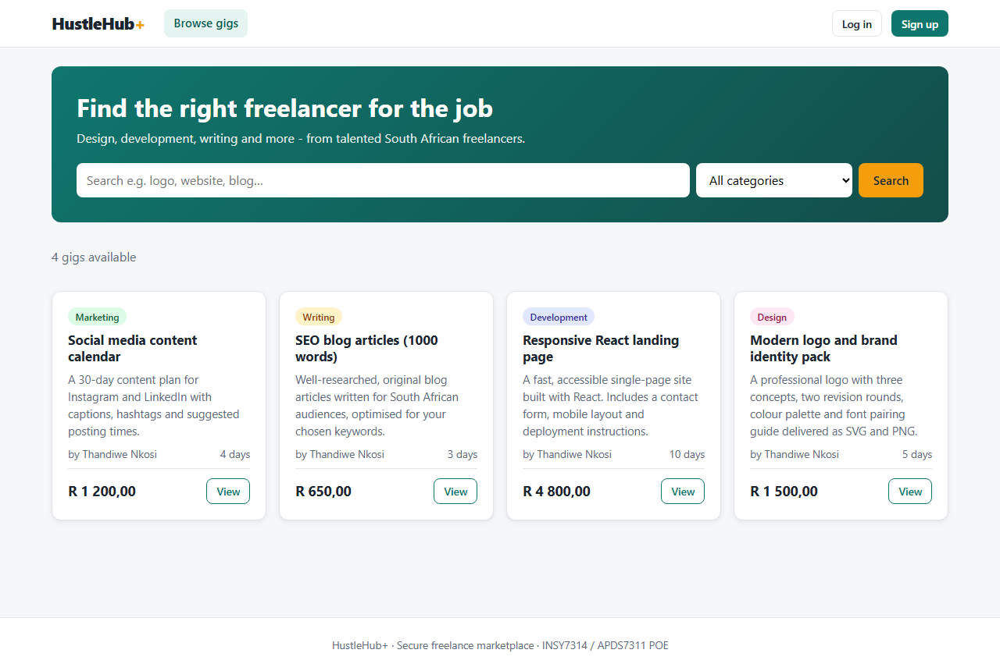 | Validation errors on registration 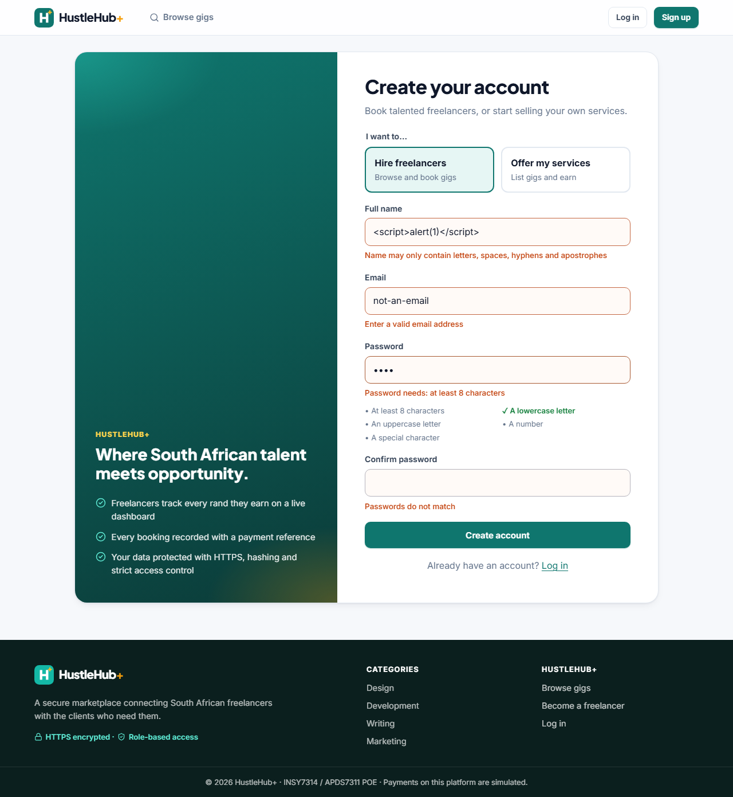 |
| Freelancer creates a gig 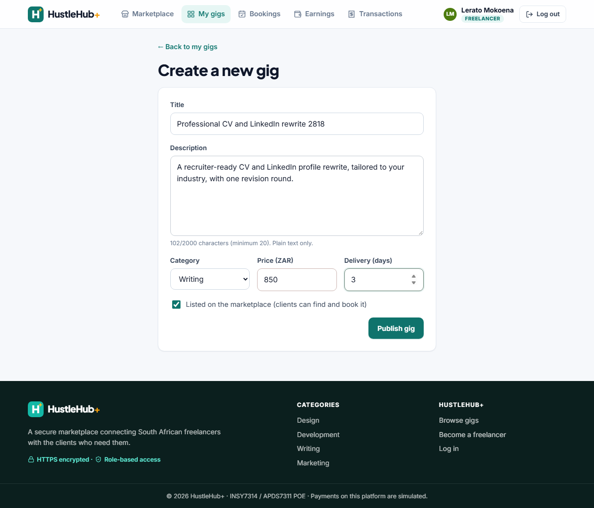 | Client books (simulated payment) 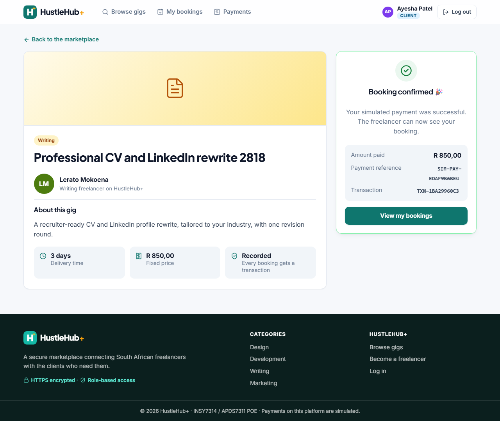 |
| Client payment history 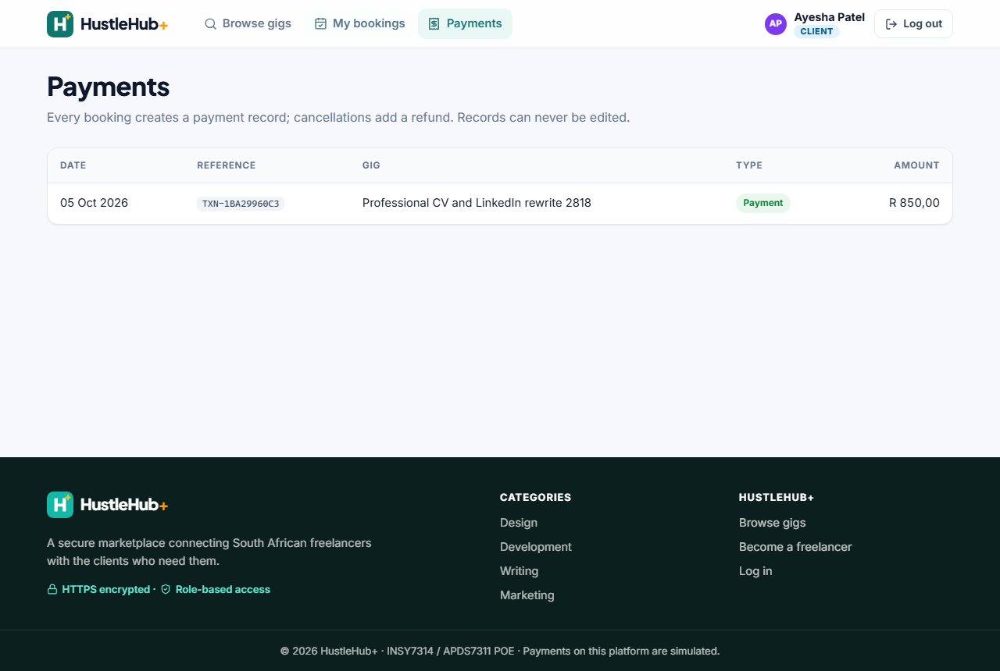 | RBAC: client blocked from freelancer page 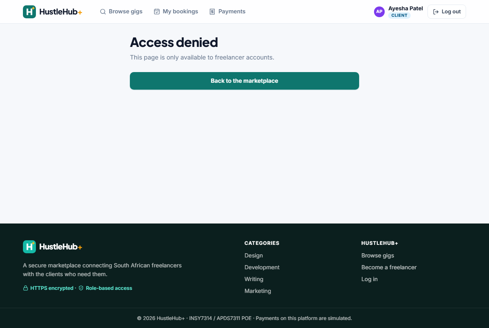 |
| Freelancer bookings 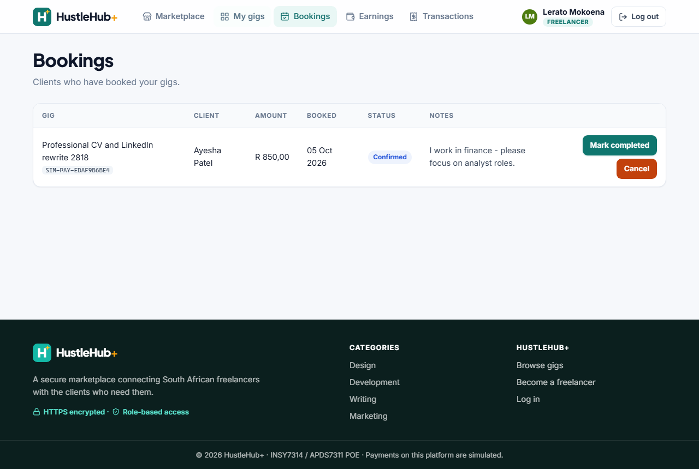 | Freelancer earnings (income tracking) 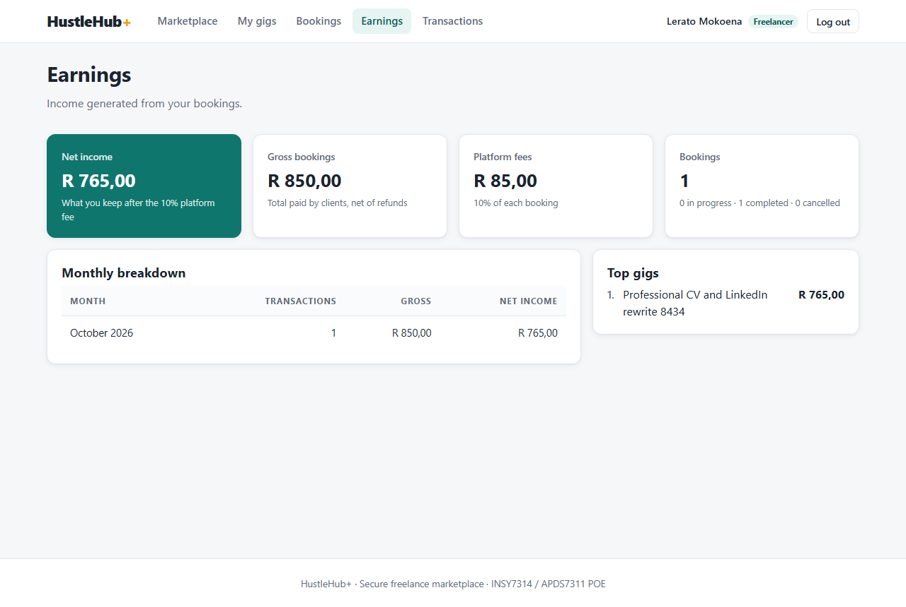 |
| Freelancer transactions with fee split 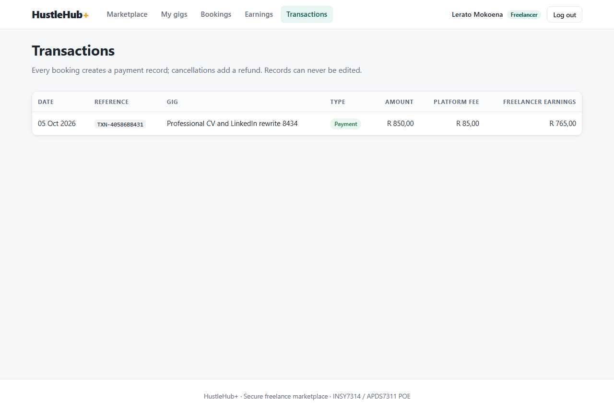 | Admin dashboard 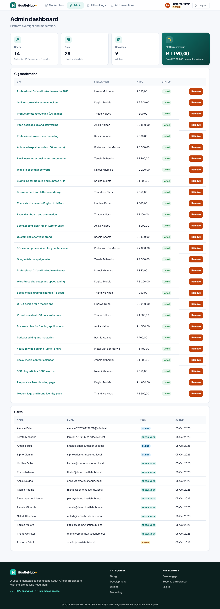 |

Part 1 screenshots (API responses) are in [`docs/screenshots/part1`](docs/screenshots/part1).

---

## 11. Known Limitations and Part 3 Plan

- **No multi-document transactions:** standalone MongoDB doesn't support them, so if recording a payment fails the booking is rolled back manually in `bookingService`. A replica set (e.g. Atlas) would allow true ACID transactions.
- **Payments are simulated**, as the brief allows. `simulatePayment()` is isolated behind one function so a real gateway could replace it.
- **Self-signed certificates** are for local development only; production would use a CA-issued certificate.
- **Dev-only advisories:** `npm audit --omit=dev` reports **0** vulnerabilities for the API and client. The remaining advisories are in dev-only tooling (Newman and its reporter, the `selfsigned` certificate generator), which never runs in production.

**Part 3 will add:** tax estimation and charts on the earnings dashboard, a GitHub Actions CI/CD pipeline (install, test, Newman, build, static analysis, security scans), Dockerfiles for `api/` and `client/` with Docker Compose, cloud-based logging and monitoring, two additional security features, and a final threat-by-threat security review.

---

## 12. References

[1] OWASP Foundation, "Password Storage Cheat Sheet," *OWASP Cheat Sheet Series*, 2023. [Online]. Available: https://cheatsheetseries.owasp.org/cheatsheets/Password_Storage_Cheat_Sheet.html. [Accessed: 27-Jul-2026].

[2] M. Jones, J. Bradley, and N. Sakimura, "JSON Web Token (JWT)," RFC 7519, Internet Engineering Task Force (IETF), May 2015. [Online]. Available: https://www.rfc-editor.org/rfc/rfc7519. [Accessed: 27-Jul-2026].

[3] OWASP Foundation, "OWASP Top Ten," *OWASP*, 2021. [Online]. Available: https://owasp.org/www-project-top-ten/. [Accessed: 27-Jul-2026].

[4] OWASP Foundation, "Input Validation Cheat Sheet," *OWASP Cheat Sheet Series*, 2023. [Online]. Available: https://cheatsheetseries.owasp.org/cheatsheets/Input_Validation_Cheat_Sheet.html. [Accessed: 27-Jul-2026].

[5] OpenJS Foundation, "Express — Node.js Web Application Framework," *Express.js Documentation*, 2024. [Online]. Available: https://expressjs.com/. [Accessed: 27-Jul-2026].

[6] Mozilla Developer Network, "HTTP Strict Transport Security (HSTS)," *MDN Web Docs*, 2024. [Online]. Available: https://developer.mozilla.org/en-US/docs/Web/HTTP/Headers/Strict-Transport-Security. [Accessed: 27-Jul-2026].

[7] Node.js Foundation, "HTTPS," *Node.js Documentation*, 2024. [Online]. Available: https://nodejs.org/api/https.html. [Accessed: 27-Jul-2026].

[8] Helmet.js, "Helmet Documentation," 2024. [Online]. Available: https://helmetjs.github.io/. [Accessed: 27-Jul-2026].

[9] OWASP Foundation, "Insecure Direct Object Reference Prevention Cheat Sheet," *OWASP Cheat Sheet Series*, 2023. [Online]. Available: https://cheatsheetseries.owasp.org/cheatsheets/Insecure_Direct_Object_Reference_Prevention_Cheat_Sheet.html. [Accessed: 05-Oct-2026].

[10] OWASP Foundation, "Testing for NoSQL Injection," *OWASP Web Security Testing Guide*, 2023. [Online]. Available: https://owasp.org/www-project-web-security-testing-guide/latest/4-Web_Application_Security_Testing/07-Input_Validation_Testing/05.6-Testing_for_NoSQL_Injection. [Accessed: 05-Oct-2026].

[11] Mozilla Developer Network, "Content Security Policy (CSP)," *MDN Web Docs*, 2025. [Online]. Available: https://developer.mozilla.org/en-US/docs/Web/HTTP/CSP. [Accessed: 05-Oct-2026].

[12] OWASP Foundation, "Cross Site Scripting Prevention Cheat Sheet," *OWASP Cheat Sheet Series*, 2023. [Online]. Available: https://cheatsheetseries.owasp.org/cheatsheets/Cross_Site_Scripting_Prevention_Cheat_Sheet.html. [Accessed: 05-Oct-2026].

[13] Mongoose, "Mongoose ODM Documentation," 2025. [Online]. Available: https://mongoosejs.com/docs/. [Accessed: 05-Oct-2026].

[14] Meta Open Source, "React Documentation," 2025. [Online]. Available: https://react.dev/. [Accessed: 05-Oct-2026].

[15] N. Freeman, "express-rate-limit Documentation," 2025. [Online]. Available: https://express-rate-limit.mintlify.app/. [Accessed: 05-Oct-2026].

[16] Postman, Inc., "Run collections using Newman CLI," *Postman Docs*, 2025. [Online]. Available: https://learning.postman.com/docs/collections/using-newman-cli/command-line-integration-with-newman/. [Accessed: 05-Oct-2026].

[17] Testing Library, "React Testing Library," 2025. [Online]. Available: https://testing-library.com/docs/react-testing-library/intro/. [Accessed: 05-Oct-2026].

[18] OWASP Foundation, "Mass Assignment Cheat Sheet," *OWASP Cheat Sheet Series*, 2023. [Online]. Available: https://cheatsheetseries.owasp.org/cheatsheets/Mass_Assignment_Cheat_Sheet.html. [Accessed: 05-Oct-2026].
